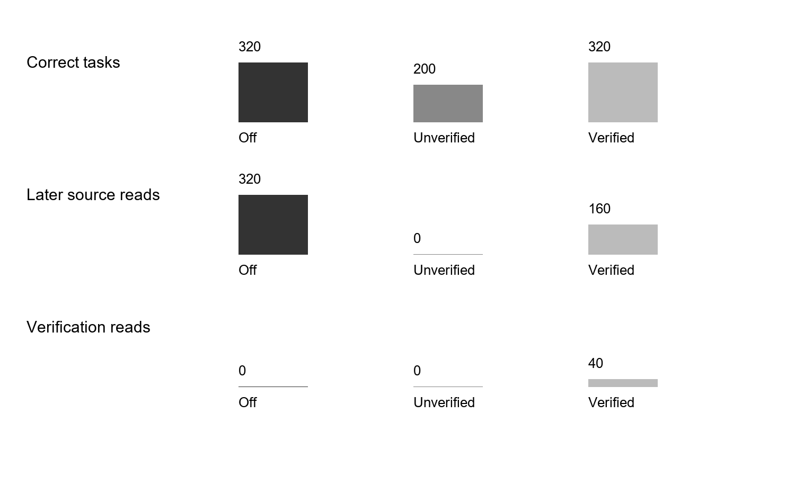

# Computational Modeling of Human Experience Formation through Practice: Evidence, Revision, Reuse, and Host-Agent Validation

Wei Xu | B.Eng. in Electronic Science and Technology | Independent Researcher, China

**Abstract—** Experience is not acquired merely by saving a piece of text. It emerges from goal-directed action, action outcomes, interpretation, counterexample testing, and subsequent reuse. Omitting any of these steps may turn an accidental success into an apparent rule. This paper models this human process as a computational cycle of practice, observation, interpretation, validation, experience, and renewed practice. Experience is represented by an object containing a claim, conditions, version, provenance, evidence, counterexamples, and lifecycle state. Candidate, stable, disputed, and invalidated knowledge are distinguished. Persistent version chains, provenance constraints, conflict records, explicit unknown outcomes, and host-context recovery allow applicability to be checked before the next action. Beta–Bernoulli updating describes changes in belief under limited evidence, information gain ranks informative verification actions, and Thompson sampling serves only as an optional exploration controller; the overall system is not characterized as Bayesian reinforcement learning. We first explain the experience-formation process, then present state transitions, update and recovery algorithms, and complexity, followed by mechanism experiments with 10 seeds, 12 rounds, and seven conditions, and separate 10-seed Bayesian bandit controls. In the rule-reuse benchmark, B2 improves completion by 4.51 percentage points over an exact-index baseline and reduces source reads by 81.60%, while increasing local logical operations by 41.53% and providing no latency advantage. These results support experience reuse within bounded contractual tasks; they do not demonstrate self-evolution of model parameters or general improvements in language-model capability.

**Index Terms—** Practical experience; experience lifecycle; evidence constraints; version revision; host agent; Bayesian evidence updating.

### Author and Acknowledgments

Wei Xu holds a Bachelor of Engineering degree in Electronic Science and Technology. This research was conducted independently after graduation. The author thanks Yancheng Institute of Technology for the laboratory environment, coursework, and knowledge acquired during his studies. This statement describes educational background and acknowledgment only; it does not identify the institute as the author's affiliation or the institution conducting this research.

## I. Introduction: Experience as Knowledge Tested through Practice

When addressing a problem, a person generally begins with a goal and acts using existing knowledge. Action produces an outcome, and comparison with the expected outcome yields feedback. Feedback does not automatically become experience: the outcome may be accidental, conditions may be undocumented, observations may be misinterpreted, or a formerly successful method may fail in a different environment version. The essential property of experience is the organization of action outcomes into knowledge that can be reused under explicit conditions, challenged, and revised. Agent-memory systems often emphasize storage and retrieval while leaving the validity, expiration, and correction of remembered knowledge less explicit [@Zhong2023,Wu2024].

This paper studies computational modeling of experience acquired through practice. The system, Butian, runs within a host AI application. The host supplies the model, sessions, and tools; Butian manages experience objects, evidence chains, version admission, state transitions, feedback persistence, and context recovery. Software memory is not equated with human consciousness, and textual records are not equated with parameter learning. Human practical reasoning is abstracted into an observable engineering process, whose usefulness is assessed through states, evidence, recurring errors, reuse benefits, and recovery quality.

### A. Research Questions and Contributions

RQ1 asks whether the action–outcome–reflection–validation–reuse process can be represented as a state machine preserving evidence and conditions. RQ2 asks when candidate experience may become stable and when the system must return `unknown` or record a dispute. RQ3 asks whether the mechanism reduces repeated evidence acquisition and avoids obsolete-rule errors under version changes, source outages, and service restarts. RQ4 concerns the distinct roles of Bayesian updating and exploration strategies. The contributions are a layered definition of practical experience, algorithms from evidence production to revision, multi-round mechanism experiments using the real `ButianService`, independent numerical controls, and explicit boundaries between host-AI evidence and mechanism experiments.

### B. Related Work and Positioning

Experiential-learning research connects concrete experience, reflection, conceptualization, and subsequent experimentation. The systematic review of Kolb's model emphasizes context and reflection [@Howard2020]. Accordingly, we distinguish having performed an action from having formed reusable experience: an individual occurrence is an event, an explanation is a candidate claim, and subsequent practice supplies further support or counterexamples. This relationship informs the research design; it does not imply a software threshold of two successes. That threshold is an auditable engineering choice requiring sensitivity analysis in specific task families.

Agent research provides complementary references. Reflexion converts task feedback into verbal reflection, and Voyager supports subsequent exploration through reusable skills [@Shinn2023,Wang2023]. MemoryBank studies long-term memory, while LongMemEval evaluates cross-session memory [@Zhong2023,Wu2024]. These studies do not independently establish the correctness of our thresholds or version rules. Here, provenance, nonduplicated evidence, renewed verification after version changes, and preserved disputes are placed within one practical process and examined separately. Retrieval-augmented generation provides access to external information [@Lewis2020], but retrieving relevant text still leaves an applicability decision to be made.

### C. Organization

Section II defines the events within a practical episode. Section III explains candidate experience, evidence, counterexamples, versions, and reuse admission. Section IV presents algorithms and implementation. Sections V and VI describe experiments and results. Section VII discusses the roles of Bayesian components, engineering benefits, and limitations. Section VIII concludes. Mathematical tools support, rather than replace, the central account of experience formation.

## II. A Process Model of Experience Formation through Practice

### A. From Goals to Action Outcomes

At time $t$, let a person face goal $G_t$, environment $E_t$, and existing knowledge $M_t$. The person proposes action $A_t$, changes the environment through tools or physical action, and obtains observation $O_t$. The difference between the expected observation $\hat{O}_t$ and actual observation produces feedback $F_t=O_t-\hat{O}_t$. This is not merely a correct/incorrect label. An unexecuted action has no interpretable outcome; success cannot be transferred when the environment version is unknown; observations without provenance cannot be audited; and one occurrence does not establish statistical stability. The model therefore retains actions, environment snapshots, observation provenance, and outcome evidence rather than a summary alone.

$$
(G_t,E_t,M_t,A_t)\rightarrow O_t\rightarrow F_t \tag{1}
$$

### B. From Feedback to Candidate Knowledge

Reflection asks what happened, why it happened, and under which conditions it may be reused. Candidate experience $e$ contains claim $h$, applicability conditions $c$, environment version $v$, provenance $s$, evidence set $E$, and counterexample set $X$. A candidate is a testable interpretation, not an established fact. Outcomes without conditions create overly broad candidates; interpretations without provenance cannot be audited; deleting counterexamples obscures applicability boundaries.

$$
e=(h,c,v,s,E,X,l,\theta) \tag{2}
$$

Here $l$ is lifecycle state, and $\theta$ summarizes evidence-supported belief. It is an estimate under the current evidence and working prior, not the probability of truth. A candidate may progress to `warm` only after further successful predictions in practice and in the absence of unresolved counterexamples.

### C. Renewed Practice and Revision

A subsequent task first checks whether its conditions satisfy $c$ and $v$. After adoption, the first-action outcome is frozen so that later answers cannot contaminate first-attempt evaluation. A successful prediction adds an observation with an independent key and evidence reference. Failure adds a counterexample and initiates dispute or revision. When sources, tools, or termination status cannot be confirmed, the result is `unknown`. Revision creates a new version with its parent, reason for change, and evidence rather than overwriting the earlier account.

### D. Running Example: Formation of a Calibration Rule

Consider a sensor using a linear conversion in version v1. The first task specifies the entity, software version, and raw measurement. The host selects a rule from source material and produces an output; an instrument-calibration record supplies outcome evidence. Instead of recording a universal rule, the system creates the candidate that rule $h$ is effective for entity $a$, version v1, and the stated measurement range. A second success with a different calibration sample and evidence digest satisfies the local threshold. Different files may nevertheless originate from the same erroneous source: deduplication removes recognized duplicates but cannot guarantee statistical independence.

After an update to v2, the old conditions no longer cover the task. The system should seek v2 evidence and retain `unknown` if that evidence is unavailable. Once sources recover, it creates a revision and tests it in further practice. Failure under genuinely matching v1 conditions attaches a counterexample to the original claim and changes its state to `disputed`; a more confident explanation cannot erase that failure. This example connects goals, actions, evidence, candidates, reuse, drift, and revision as one process.

### E. Five Essential Stages

The process requires goal specification, action, observable outcomes, validation, and renewed practice. Without a target problem, experience has no task of application. It must constrain actual action, retain outcome evidence, check conditions and counterexamples, and be tested again in later tasks. Butian's state machine, evidence tables, version tables, recovery mechanism, and feedback interfaces implement observable counterparts of these stages. Omitting a stage leaves a log, a retrieval result, or a candidate claim rather than a complete experience process.

## III. Experience Lifecycle: From Candidates to Reusable Knowledge

### A. States

`candidate` denotes experience from one or a few episodes that has not met stable-use conditions. `warm` denotes experience meeting the specified success and evidence thresholds and eligible for retrieval under matching conditions. `hot` denotes recently effective and frequently used experience; frequency is not additional proof of correctness. `disputed` records counterexamples, conflicts, or environmental mismatch and is not unconditionally reusable. `invalidated` records a claim known to no longer hold. `unknown` describes an unresolved observation or task outcome, not a memory-temperature state alongside `candidate`. The implementation also includes maintenance states such as `cold`, `archived`, and `pending_validation`. These names describe program records, not psychological states.

$$
s\ge2,\ f=0:\quad\mathrm{candidate}\rightarrow\mathrm{warm} \tag{3}
$$

$$
\mathrm{failure}:\quad\mathrm{warm}\rightarrow\mathrm{disputed} \tag{4}
$$

### B. Entry Requirements

External articles and host responses can supply candidate sources but cannot directly establish stable local experience. Entry requires a claim, applicable task, source event, environment or version information, and a traceable outcome. A `success` must include `evidence_ref`. The `independent_key`, evidence digest, and optional content hash support deduplication. Repeated use of one file cannot masquerade as independent practice.

### C. Reuse Admission

Admission identifies the task entity and target version, retrieves candidates, and then checks uniqueness, content completeness, conditions, and parent-chain continuity. Conflicts or budget truncation cause fallback to the exact source; unavailable sources yield `unknown`. This models recalling context and comparing conditions before using prior experience. Production `compose_context` supplies candidates only. The research parser and host perform final admission, so retrieval itself must not be described as understanding.

### D. Effects of Failure

Failure does not silently delete experience. Its evidence, environment, version, and first answer are retained. Failure of mature experience produces `disputed`; failure of a candidate remains in its observations and blocks unconditional promotion. Narrowed applicability creates a revision, whereas a wholly unsupported claim can become `invalidated`. The record preserves why the claim was previously accepted and why it is now revised.

## IV. Algorithms and Implementation

### A. Algorithm 1: Practice Recording and Candidate Creation

Inputs are goal $G$, action $A$, environment snapshot $E$, observation $O$, provenance $s$, and expectation $\hat{O}$. An unfinished action or missing evidence is recorded as `unknown` and cannot trigger promotion. Success creates or retrieves an experience object and checks independent keys, evidence digests, and content hashes; duplicate evidence is rejected. Failure records a counterexample and changes mature experience to `disputed` or retains a candidate. Observations, evidence digests, experience versions, and domain-skill updates commit within one `BEGIN IMMEDIATE` transaction in `MemoryStore`. `ButianService` subsequently appends `practice_observed` to a separate service store. These operations are not a cross-database atomic commit.

$$
r_t\in\{\mathrm{success},\mathrm{failure},\mathrm{unknown}\} \tag{5}
$$

### B. Algorithm 2: Beta Updating of Experience Belief

Under the working model that a claim succeeds on the next condition-matching task, let $\theta\sim\mathrm{Beta}(\alpha,\beta)$. Evidence weight is $w=qdm$, where $q$ is evidence quality, $d$ an independence assessment, and $m$ environment match. Success yields $\alpha'=\alpha+w$, $\beta'=\beta$; failure yields $\alpha'=\alpha$, $\beta'=\beta+w$. The posterior mean is $\mu=\alpha/(\alpha+\beta)$. Its increase after success is $\Delta\mu=w\beta/[(\alpha+\beta)(\alpha+\beta+w)]$. Thus success increases working belief with diminishing marginal change as parameters grow. This characterizes evidence accumulation without proving the claim.

$$
\theta\sim\mathrm{Beta}(\alpha,\beta),\quad\mu=\frac{\alpha}{\alpha+\beta} \tag{6}
$$

Production `record_practice_outcome` currently uses bounded adjustments of `confidence`: failure subtracts 0.1, and qualifying candidate promotion adds 0.1. It does not automatically call `BetaBelief`. The Beta model is an optional representation supported by the mathematical module and controls; production confidence is not a Beta posterior. Fractional weighting approximates a weighted likelihood and does not solve evidence duplication. Independence assessment requires higher-level deduplication and environmental review. A posterior cannot bypass version admission or practice thresholds, and `warm` does not mean proved.

### C. Algorithm 3: Candidate Selection and Information Gain

For actions that may reduce uncertainty, information gain is $\mathrm{IG}=H(p_{\mathrm{prior}})-H(p_{\mathrm{posterior}})$; a cost-adjusted score is $\mathrm{IG}-\lambda\,\mathrm{cost}$. Expected information gain has a mutual-information interpretation only when the posterior distributions and outcome probabilities satisfy normalization and mixture consistency. Butian's `expected_information_gain` checks explicit posterior dimensions, outcome probabilities, and mixture consistency. It does not infer posteriors automatically from prose.

$$
\mathrm{EIG}=H(p)-\sum_y r_yH(p(\cdot|y)) \tag{7}
$$

### D. Algorithm 4: The Role of Thompson Sampling

Thompson sampling allocates exploration among actions or strategies awaiting verification; it is not the experience-formation process. Arm $k$ maintains $\mathrm{Beta}(\alpha_k,\beta_k)$. Each round samples $\tilde{\theta}_k$, selects the largest sample, and updates only the selected arm using Bernoulli feedback. Selection costs $O(K)$ and updating costs $O(1)$. Without state transitions, long-term returns, or value functions, the current component is a context-free Bayesian bandit rather than full Bayesian reinforcement learning.

### E. Algorithm 5: Recovery after Restart

Recovery reads committed events, current experience versions, parent chains, and unfinished tasks before reconstructing candidate context. A `prepared` event without `committed` status cannot establish successful external action. Unconfirmed tool termination remains `unknown`. A version mismatch permits only candidate use and renewed evidence acquisition. Recovery continues the practical process rather than merely reinserting old text into context.

### F. Pseudocode with Inputs, Outputs, and Error Branches

The responsibility boundaries below are explicit. Algorithm 1a is the production practice interface; Algorithms 2a–4a are mathematical modules. Algorithm 5a describes host-side recovery and admission rather than a single implemented function. Algorithm 6 is the actual main-experiment path and writes `warm` directly; it does not replace candidate validation through Algorithm 1a. Numbers indicate execution order; blocks terminate with END.

#### Algorithm 1a. Record Practice Feedback (Production Interface)

```text
01 INPUT: member, memory_id, content, outcome, independent_key, evidence_ref
02 OUTPUT: memory_id, status, successes, failures; or an explicit error
03 REQUIRE outcome IN {success, failure, unknown}; independent_key nonempty
04 IF success AND no evidence_ref: RAISE practice_success_evidence_required
05 Service checks evidence ownership and content hash; RAISE if invalid
06 BEGIN IMMEDIATE (member-memory transaction)
07 IF independent key or evidence reference/digest already used: RAISE duplicate
08 Read experience; create candidate if absent; check requested content hash
09 Insert observation, environment, digest; count successes s and failures f
10 IF failure: mature -> disputed; otherwise retain candidate; reduce scores
11 ELSE IF success AND s>=2 AND f=0 AND old state IN
   {candidate,pending_validation}: set warm and increase bounded scores
12 ELSE: no promotion; unknown contributes neither success nor failure
13 Save revision, parent chain, provenance, domain statistics; COMMIT
14 ON transaction exception: ROLLBACK; rethrow
15 Append practice_observed separately; do not claim two-store rollback
16 RETURN actually committed state and counts
```

#### Algorithm 2a. Beta Evidence Summary (Optional Mathematical Module)

```text
01 INPUT: alpha>0, beta>0, outcome, q,d,m IN [0,1]
02 OUTPUT: updated parameters and mean; production lifecycle unchanged
03 Check finite parameters and valid ranges; RAISE if invalid
04 w <- q*d*m
05 IF success: alpha <- alpha+w
06 ELSE IF failure: beta <- beta+w
07 ELSE IF unknown: leave parameters unchanged
08 ELSE: RAISE invalid_outcome
09 RETURN alpha, beta, alpha/(alpha+beta)
10 NOTE: Algorithm 1a deduplicates; fractional weight proves no independence
```

#### Algorithm 3a. Rank Verification Actions (Explicit Posterior Control)

```text
01 INPUT: prior p; outcome probabilities r; posteriors p_y; cost; lambda
02 OUTPUT: EIG and cost-adjusted scores for valid actions
03 FOR EACH action a:
04   Check finite nonnegative p,r,p_y; matching dimensions; normalization
05   Check sum_y r_y*p_y[i] matches p[i] within tolerance for each i
06   RAISE if invalid; do not guess posteriors from text
07   eig[a] <- H(p)-sum_y r_y*H(p_y)
08   score[a] <- eig[a]-lambda*cost[a]
09 END FOR
10 RETURN score-ranked actions; the caller decides execution
```

#### Algorithm 4a. Thompson Exploration Allocation (Bandit Control)

```text
01 INPUT: positive alpha[k],beta[k] for K arms; random-number generator
02 OUTPUT: selected arm; its parameters updated after feedback
03 REQUIRE K>0; finite positive parameters
04 FOR k=1 TO K: sample[k] <- BetaSample(alpha[k],beta[k])
05 END FOR
06 selected <- ARGMAX sample[k], with implementation-defined tie handling
07 Execute selected; await verifiable Bernoulli reward
08 IF unknown: fabricate no reward and perform no update
09 ELSE IF reward=1: alpha[selected] <- alpha[selected]+1
10 ELSE IF reward=0: beta[selected] <- beta[selected]+1
11 ELSE: RAISE invalid_reward
12 RETURN selection and parameters; no automatic experience promotion
```

#### Algorithm 5a. Conditional Admission after Recovery (Host Workflow)

```text
01 INPUT: persisted tasks, events, experience, chains, current conditions
02 OUTPUT: auditable candidate context and outcome status; no automatic success
03 Open service and member stores; read current versions and provenance
04 Check parent chains; report corruption without inventing missing versions
05 FOR EACH unfinished action:
06   Recover committed outcomes only with verifiable evidence
07   Retain unknown for uncommitted prepared actions, unconfirmed exit,
     or missing evidence
08 END FOR
09 Retrieve candidates; admit by entity, version, completeness, and conflict
10 IF inapplicable: reacquire source; IF unavailable: RETURN unknown
11 RETURN candidates, sources, unresolved matters; host must practice again
12 NOTE: experiments test normal close/open, not arbitrary power failures
```

#### Algorithm 6. Multi-round Rule-Reuse Benchmark (Executed Research Path)

```text
01 INPUT: shared task stream, exact source archive, method, memory directory
02 OUTPUT: first answers; correct/wrong/unknown; read/query/write counts
03 IF memory enabled: compose_context; parse a unique entity rule
04 IF version admission enabled: reject mismatch; ELSE permit old rules
05 IF no usable rule AND source_available: scan or read exact index
06 answer <- fixed solve(rule,task); freeze first answer
07 Score against reference; later correction cannot change first score
08 IF first answer wrong AND source_available: reacquire correct rule
09 IF source acquired AND writes allowed: append_event;
   MemoryStore.put(status=warm,confidence=1)
10 At round 8 close/open; no-persist switches to an empty directory
11 RETURN round record; repeat for subsequent rounds
12 NOTE: no candidate validation, automatic induction, or disputed-state study
```

### G. Dream Consolidation, Hypothesis Verification, and Subsequent Practice

Dreaming is offline organization of existing practice material. `DreamRunner.run` creates a source snapshot when material volume, new-material, interval, and budget thresholds are met. The host supplies distilled summaries, abstractions, and hypotheses; the system does not derive rules automatically from text. `distill` preserves source references, `abstract` retains support, counterexamples, and conditions, and `propose` checks continuing source validity. Verification must pass `schedule` and `start` before supported or rejected outcomes are accepted, and evidence is checked by the service. `supported` creates only a `candidate`; later successful practice is still required for `warm`. Verification separates testable hypotheses from unchecked generalization without guaranteeing correctness on arbitrary tasks.

#### Algorithm 7. Dream Formation and Reuse after Verification

```text
01 INPUT: practice material, host-proposed rule, verification budget, later tasks
02 OUTPUT: supported/rejected/unknown; candidate; later practice records
03 Check new material, interval, budget; skip consolidation if unmet
04 Freeze sources; host distills, abstracts conditions, and proposes hypothesis
05 Schedule verification; start only if authorized and sources remain valid
06 Execute probes distinct from training; save observations and evidence
07 IF counterexample: record rejected; use source fallback on later tasks
08 ELSE IF insufficient evidence: record unknown; do not claim validation
09 ELSE: record supported and create candidate
10 Freeze first outcomes and record independent practice feedback during reuse
11 Promote to warm only at production threshold; preserve failure evidence
12 RETURN verification/reuse ledger; supported does not mean universal validity
```

### H. Conditional Propositions for the Bounded Loop

Proposition 1: If every state update uses the `MemoryStore` practice interface, candidate promotion requires at least two success observations passing interface deduplication and no failures. The promotion branch establishes this by checking counts transactionally and requiring the prior state to be `candidate` or `pending_validation`. This proves a program gate, not external evidence truth, and it does not cover manual writes bypassing the interface. Two successes are necessary at this interface, not sufficient for general validity.

Proposition 2: If the current task version is identifiable and the host strictly enforces version admission, an old-version candidate cannot directly yield an accepted current-version result. Matching candidates proceed normally; mismatches require new evidence or `unknown`. The claim depends on actual version identification and enforcement. The `no-version` ablation removes that assumption; its errors demonstrate the guard's role rather than universal immunity to errors.

Proposition 3: An `unknown` observation contributes neither a success nor a failure. Counting includes only the corresponding explicit outcomes. Unknown observations can retain records and versions but cannot increase support. This prevents missing sources or unconfirmed termination from being interpreted as success. Unknown outcomes still reduce completion and remain in the evaluation denominator; they are the cost of honestly representing uncertainty.

A complete process also requires host execution, reliable observations, and later reuse. Database success establishes persistence only. Validity across tasks requires external outcomes, and long-term benefits require cross-round controls. Executable closure and epistemic correctness are therefore argued separately: interfaces, transactions, and recovery controls support the former; the stated task families bound the latter.

### I. Complexity and Implementation Boundaries

Practice writes involve a fixed set of table-operation types, but success/failure counting and domain aggregation grow with observations. For $N$ relevant observations and $N_d$ domain observations, conservative aggregation cost is $O(N+N_d)$ without stronger index guarantees. The entire feedback operation is not $O(1)$, and a fixed number of SQL statements does not make their runtime constant. Current OR-LIKE retrieval costs conservatively $O(ML)$ for $M$ experiences of average content length $L$. Candidate parsing costs $O(B)$ for $B$ context characters; version-chain checking costs $O(V)$; Beta updating is $O(1)$; Thompson selection is $O(K)$. Pareto budget allocation depends on frontier size, capped at 100000. These are program costs, not host-token costs or human cognitive complexity.

## V. Experimental Design

### A. Main Experiment and Scope

The main experiment is a rule-reuse benchmark, not a test of the full experience-formation process. Its `remember` function calls `MemoryStore.put` directly with `warm` and confidence 1.0, bypassing candidate thresholds, independent practice validation, and disputed-state handling. A generator supplies entities and versions; a fixed solver applies rules; an evaluator compares references; source rules are then cached for later reuse. No language model is called. The experiment measures infrastructure supporting a practical cycle rather than language generation. Ten seeds, 12 entities, 12 rounds, and seven conditions produce 10080 executions. Version drift occurs in rounds 5 and 9, source outages in rounds 6 and 7, and normal service close/reopen in round 8.

### B. Conditions and Controls

`B0-scan` scans the archive every round; `B0-index` uses an exact version index. `B1-static` writes only in the first round. `B2-full` enables retrieval, version checking, source fallback, feedback writes, and persistence. `no-version` removes admission, `no-write` disables experience writes, and `no-persist` uses an empty directory after restart. First outcomes are frozen before feedback, and correct, wrong, and unknown are mutually exclusive. The statistical units are the 10 seeds, not repeated rounds treated as independent samples.

### C. Metrics and Hypotheses

Primary measures are first-attempt completion, version errors, unknown outcomes, and source reads. Secondary measures include context queries, writes, logical operations, local runtime, and version-chain audits. H1 predicts fewer repeated source reads and avoidance of obsolete rules under drift and outages with version admission. H2 predicts retained reusable experience after restart. H3 allows increased local overhead, so fewer source reads need not imply lower end-to-end latency.

### D. Lifecycle Interface Control and Limitations

A separate 24-directory control uses `record_practice_outcome`: first success creates a candidate; the same evidence with a new independent key is rejected; a second distinct evidence item promotes to `warm`; failure produces `disputed`; the script manually revises to `candidate`; normal close/open is followed by checks of content, parent chains, and retrieval. This verifies state guards, not autonomous host induction, true evidence independence, or claim correctness. Evidence and revisions are scripted. Twenty-four repetitions are not 24 scientific discoveries. This control complements rule reuse but is not one end-to-end experiment jointly measuring formation and task benefit.

### E. Paired Replay of Dream Effects

Ten seeds generate linear and saturating sensors, yielding 20 material groups. Initial observations are at x=1,2,3. The current host proposes an affine candidate based on equal adjacent differences; Python replays this fixed induction template through production dream interfaces. The no-dream condition reads sources for each problem. Unverified reuse adopts the candidate directly. Verified reuse probes x=5,10, rejects and falls back on a counterexample, or saves a candidate and records subsequent feedback. Tests at x=4,7,9,12 repeat over four rounds, giving 320 tasks per condition. Probe and test inputs differ. Each condition has identical initial material and 60 training reads. Saturating sensors plateau above x=6, so the initial three points cannot distinguish the families. This examines overgeneralization and verification cost; it is not a blinded autonomous-discovery study and supplies no independent model samples.

### F. Independent Algorithm Controls

A separate two-arm Bernoulli experiment runs 10 fixed seeds and 1000 rounds per seed with reward probabilities 0.30 and 0.70, comparing Thompson sampling, epsilon-greedy, and uniform random selection. It tests exploration allocation only, has `actual_model_runs=0`, and is neither the main practical experiment nor a full Bayesian-RL study.

## VI. Results: Benefits and Costs of Experience Reuse

### A. Main Results

Table 1. First-attempt outcomes and evidence-acquisition costs.

| Condition | First-attempt completion | Wrong | Unknown | Source reads |
| --- | --- | --- | --- | --- |
| B0-scan | 1375/1440 | 0 | 65 | 42287 |
| B0-index | 1375/1440 | 0 | 65 | 1375 |
| B1-static | 1400/1440 | 0 | 40 | 752 |
| B2-full | 1440/1440 | 0 | 0 | 253 |
| no-version | 1307/1440 | 133 | 0 | — |
| no-write | 1375/1440 | 0 | 65 | 1375 |
| no-persist | 1440/1440 | 0 | 0 | 373 |

B2-full names all switches of the rule-reuse policy, not the full experience lifecycle. Relative to exact indexing, completion improves by 4.51 percentage points, with a seed-cluster bootstrap 95% interval of [3.68,5.35]. Reads fall from 1375 to 253, an 81.60% reduction. Removing version checks produces 133 obsolete-rule errors: version is an applicability condition, not an incidental field. Discarding experience on restart adds 120 reads, showing that persistence changes subsequent evidence-acquisition actions.


Figure 1. Outcomes under round-specific drift, outages, and restart.


Figure 2. Effect of reuse on cumulative source access.

### B. Round-by-round Attribution

Table 2a. First outcomes by round and B2 external-source reads.

| Round | Index correct/120 | B2 correct/120 | B2 reads |
| --- | --- | --- | --- |
| 1 | 120 | 120 | 120 |
| 2–4 (each) | 120 | 120 | 0 |
| 5 (drift) | 120 | 120 | 70 |
| 6 (outage) | 99 | 120 | 0 |
| 7 (outage) | 76 | 120 | 0 |
| 8 (restart) | 120 | 120 | 0 |
| 9 (drift) | 120 | 120 | 63 |
| 10–12 (each) | 120 | 120 | 0 |

Both policies read 120 sources in round 1, providing no cold-start advantage. In rounds 2–4, B2 reuses unchanged rules while indexing still reads 120 sources per round; accuracy is identical. Round 5 updates 70 entity instances: admission rejects 70 old rules and reacquires sources while retaining the other 50. Round 9 requires 63 new reads. Thus total B2 reads decompose exactly as 120+70+63=253; 1122 avoided reads arise from subsequent repeated tasks.

All completion differences occur in rounds 6 and 7. The index returns 21 and 44 unknown outcomes because sources are unavailable; B2 solves these 65 tasks using previously saved version-matching rules. Both solve all 1375 available-source tasks. Among the 65 unavailable-source tasks, index completion is 0/65 and B2 completion 65/65. The 4.51-point gain is therefore an information-availability benefit under this protocol, not stronger reasoning, formulas, or language understanding. Updating rules in round 5 before outages gives B2 a learning opportunity; simultaneous first-time version changes and outages are not covered.

Without admission, 70 round-5 and 63 round-9 tasks use obsolete rules, totaling 133 first-attempt errors. Feedback occurs after freezing the first answer. Available sources then correct the cache, preventing propagation into later stable rounds. After normal restart, B2 has 120 hits, whereas the empty-directory policy rereads 120 sources. Both solve 120/120. Here persistence avoids rereading; it does not improve round-8 accuracy or guarantee power-failure recovery.

### C. Operation Costs and Boundaries

Table 2. Operation ledger for experience formation and reuse.

| Condition | Reads R | Queries Q | Writes W | Logical operations |
| --- | --- | --- | --- | --- |
| Exact index | 1375 | 0 | 0 | 1375 |
| B2-full | 253 | 1440 | 253 | 1946 |
| B1-static | 752 | 1440 | 120 | 2312 |
| no-persist | 373 | 1440 | 373 | 2186 |

B2-full increases logical operations by 41.53%, averaging 8.44 ms locally versus approximately 0.0102 ms for indexing. The mechanism reduces source acquisition and obsolete-rule errors, not necessarily latency. This local benchmark does not measure human learning cost. With equal operation weights, reuse has no total-operation advantage. Savings may outweigh management overhead only when external reads are sufficiently more expensive than local retrieval and writes. External fees, network latency, and model tokens were not measured, so an application break-even point cannot be established.

### D. Independent Bayesian Bandit Control

Table 3. Exploration-allocation control.

| Policy | Mean total reward | Mean pseudo-regret | Seeds |
| --- | --- | --- | --- |
| Thompson | 704.4 | 4.32 | 10 |
| epsilon-greedy | 672.8 | 25.44 | 10 |
| Uniform | 494.3 | 202.60 | 10 |

Thompson sampling concentrates relatively quickly on the higher-reward arm in this stationary two-arm Bernoulli environment. This describes the allocator, not the correctness of experience claims or reinforcement-learning capability in the host model.


Figure 3. Convergence of the high-reward candidate's Beta posterior mean.


Figure 4. Mean cumulative reward of the three exploration policies.


Figure 5. Mean pseudo-regret of the three policies.

### E. Subsequent Dream Benefits and Incorrect Generalization

Table 4. Paired outcomes for candidate verification and later reuse.

| Condition | Correct/320 | Wrong | Later source reads | Verification accesses |
| --- | --- | --- | --- | --- |
| No dreaming | 320 | 0 | 320 | 0 |
| Unverified reuse | 200 | 120 | 0 | 0 |
| Verified reuse | 320 | 0 | 160 | 40 |

Verification accepts 10 linear candidates and rejects 10 saturating candidates. Linear rules solve 160 later tasks by reuse; the other 160 use fallback. Later reads fall 50%, from 320 to 160. Including 40 verification accesses gives 200, a 37.5% reduction. Including the identical 60 training accesses per condition gives 380 versus 260, a 31.58% reduction. Unverified reuse fails on three above-threshold inputs per saturating sensor per round: 10×4×3=120 errors. Compression into a rule can lose boundaries. Verified reuse matches no-dream accuracy; its benefit is reduced acquisition rather than improved reasoning accuracy.

Accepted candidates pass through the real `record_practice_outcome`: the first success retains `candidate`, and the second promotes to `warm`. This connects dream candidates, tool verification, and later practice. However, reference outcomes come from the same synthetic generator and remain visible to the evaluator; they are not free external evidence in deployment. The induction template was specified by the host, with zero model calls during script execution. Repeated rounds within a seed are not independent samples. The results establish verification's role in this protocol, not the success rate, token cost, or cross-domain generalization of unconstrained host induction.



Figure 6. Correct tasks, later source reads, and verification accesses under the three dream conditions.

### F. Interpretation

The main study supports condition-matching reuse of known rules, not autonomous formation of claims from practice. B1 caches only the first round and can still read sources after updates; its limitation is repeated acquisition, not inevitable obsolete outputs. Formation, thresholds, and disputes are covered by a separate interface control, which cannot be combined with reuse results as if end-to-end benefit had been measured. Bandit benefits arise from exploration allocation at a different level. These data cannot be merged into one model-effect number.

## VII. Discussion: From Human Practice to Host-Agent Mechanisms

### A. What Is Modeled

The model represents the structure of practice rather than the full human mind. It retains observable goals, actions, outcomes, conditions, evidence, counterexamples, revisions, and renewed practice. Mao Zedong's *On Practice* can inform the design through its account of knowledge arising from and being tested in practice [@Mao1991Practice]. Philosophy does not prove program correctness, which instead depends on guards, transactions, and experiments. Long-term-memory research also motivates recovery of task context without equating software fields with human memory [@Zhong2023,Wu2024].

### B. Bayesian Components Are Not Experience Itself

Temporal-context models discuss the relationship between retrieval and changing contexts [@W2002]. We use this to motivate environment-aware recovery, not to establish that SQLite structures are human memory. The Thompson-sampling tutorial describes posterior-sampling exploration [@J2018]; our two-arm stationary control covers only its simplest Bernoulli case and cannot establish performance under nonstationarity, partial observability, or delayed real-host feedback.

A Beta posterior describes how evidence changes a belief summary under a working model. It does not establish understanding and does not replace counterexamples, versions, or provenance. It is one numerical component within a lifecycle. Thompson sampling allocates opportunities among verification actions; it is neither the complete formation process nor full reinforcement learning. Allocator performance and lifecycle effectiveness require separate evaluation.

### C. Host AI and Model Training

Runtime experience changes retrievable context, evidence, and policy selection, not parameters. Host AI can inspect candidates, act, and submit feedback, but its free-text responses require separate records of first answers, visible context, tool outcomes, and feedback. The current 15 same-agent, nonblinded exploratory records are not independent model experiments; the 10080 main executions also have no language-model calls. Experience may supply candidate post-training data, but parameter-change claims require fixed pre/post evaluation, forgetting assessment, and rollback evidence. Runtime writeback is not described as self-evolution.

### D. Threats to Validity

Contractual synthetic tasks and deterministic solving reduce model noise but limit external validity. Ten seeds are clusters; 1440 repeated tasks are not 1440 independent samples. Drift and outage schedules are protocol choices, not real-world distributions. Local latency does not equal network or token cost, and same-agent pilots expose previous answers. Interface regression checks verify implementation behavior and are excluded from task-benefit statistics.

## VIII. Conclusion and Future Work

This paper models experience formation as goal-directed action producing observations, comparison with expectations yielding feedback, provenance and condition checking producing candidates, and repeated practice and counterexamples determining stable or disputed states. Versions and restart recovery preserve continued verification. Butian's database, evidence, version chains, context recovery, and feedback interfaces implement observable stages of this process.

The experiments support bounded conclusions. Version-admitted rule reuse reduces source reads by 81.60% against exact indexing, while removal of version admission produces 133 obsolete-rule errors. Persistence preserves reuse across restart. Beta updating and Thompson controls follow their intended behavior in synthetic numerical environments. In the additional dream replay, verified reuse and no dreaming both solve 320 tasks, while verification-inclusive acquisition falls by 37.5%; unverified reuse yields 120 overgeneralization errors. This supports verification before reuse in the two studied families, not unrestricted free-text induction benefits. Costs include more local operations and latency. No claims are made of parameter self-evolution, full Bayesian RL, or general language-model improvement. Future work should connect this same process to real host AI and record frozen first answers, objective tool outcomes, feedback, reuse, and counterexamples round by round to test improvement on related tasks.

## References


- [Shinn2023] Noah Shinn, Federico Cassano, Edward Berman, et al., “Reflexion: Language Agents with Verbal Reinforcement Learning,” arXiv, 2023. http://arxiv.org/pdf/2303.11366v4.
- [Zhong2023] Wanjun Zhong, Lianghong Guo, Qiqi Gao, et al., “MemoryBank: Enhancing Large Language Models with Long-Term Memory,” arXiv, 2023. http://arxiv.org/pdf/2305.10250v3.
- [Mao1991Practice] Mao Zedong, “On Practice,” Selected Works of Mao Zedong, Vol. 1, Beijing: People’s Publishing House, 1991, pp. 282–297. Originally published July 1937; electronic university copy checked.
- [Lewis2020] Patrick Lewis, Ethan Perez, Aleksandra Piktus, et al., “Retrieval-Augmented Generation for Knowledge-Intensive NLP Tasks,” 2020.
- [Howard2020] M. T. Howard, “Experiential learning—A systematic review and revision of Kolb’s model,” Interactive Learning Environments, 2020, doi: 10.1080/10494820.2019.1570279.
- [W2002] H. M. W. and K. M. J., “A Distributed Representation of Temporal Context,” Journal of Mathematical Psychology, 2002, doi: 10.1006/jmps.2001.1388.
- [J2018] R. D. J., V. R. Benjamin, K. Abbas, O. Ian, and W. Zheng, “A Tutorial on Thompson Sampling,” 2018, doi: 10.1561/9781680834710.

## Appendix A. Implementation Mapping and Reproducible Experiments

The implementation mapping is as follows. Experience storage keeps the current version, parent version, and source event. Practice recording handles success, failure, and dispute transitions. Context composition and parsing retrieve candidate experience and enforce entity, version, and completeness admission. Backup and recovery preserve service state and evidence paths. The mathematical controls implement Beta updating, information gain, utility, and Thompson sampling. The paper explains the key modules, algorithms, constraints, and experimental definitions directly rather than replacing them with an undisclosed static ledger.

The reported experiments consist of deterministic mechanism replay, lifecycle controls, numerical controls, and a dream-effect comparison. Neither the main experiment nor the control experiments call a language model. The dream-effect comparison uses a host-supplied candidate template and produces evidence through real verification and recording interfaces; it is therefore not autonomous discovery or an independent model experiment. These results are mechanism evidence and cannot replace the unfinished confirmatory experiment with a real host AI.

## Appendix B. Additional Experimental Figures


Figure 7. Evidence acquisition, retrieval, and writeback operations in the practice process.


Figure 8. Seed-cluster paired effects.
