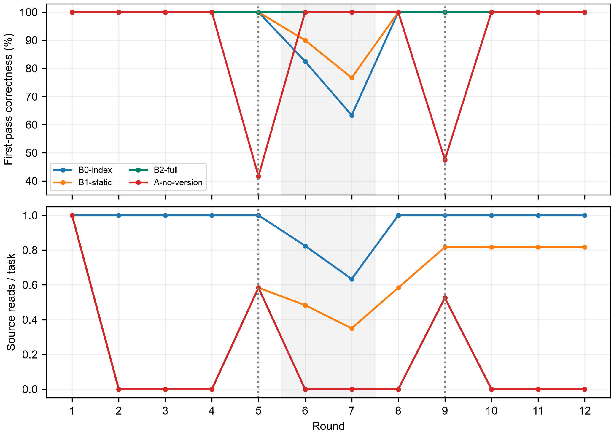
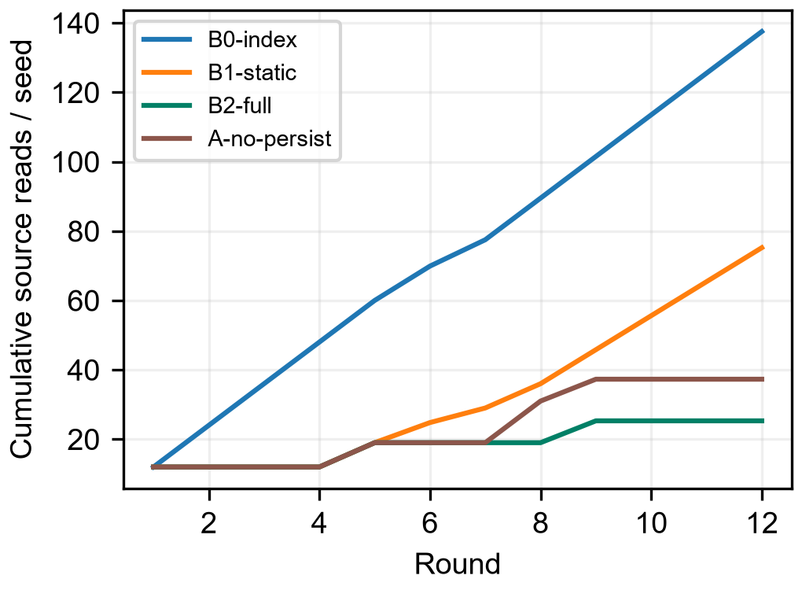
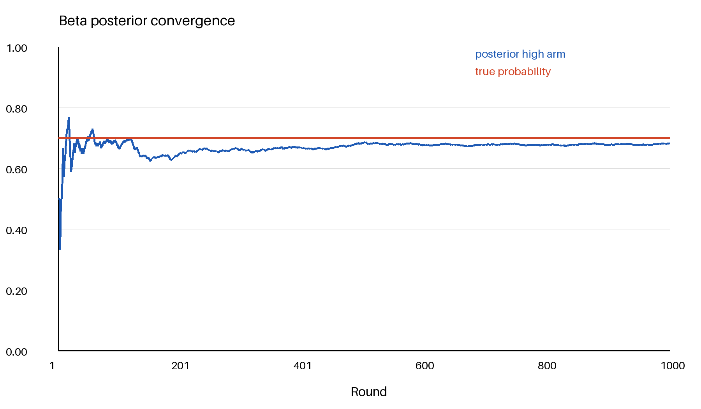
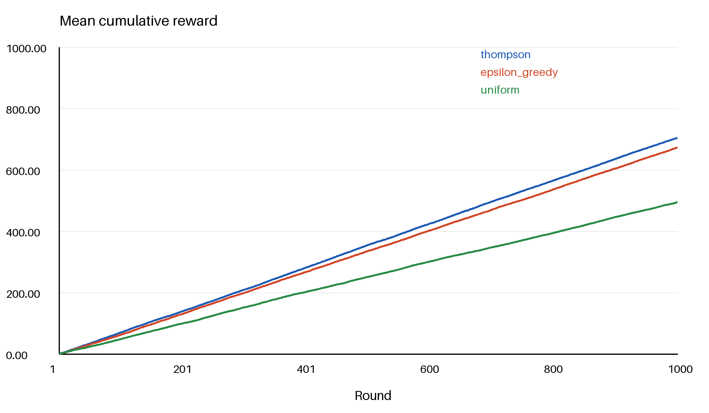
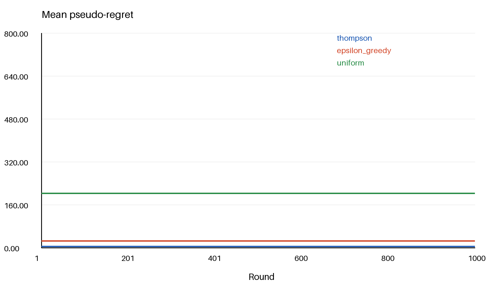
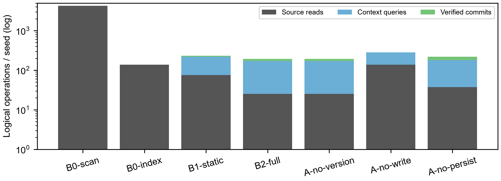
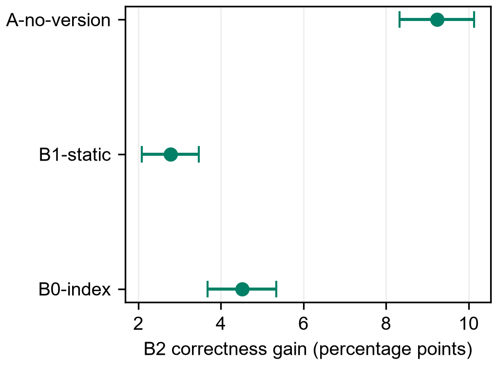

人的实践经验形成过程的计算建模：证据、修订、复用与宿主智能体验证

Computational Modeling of Human Experience Formation through Practice: Evidence, Revision, Reuse, and Host-Agent Validation

许伟｜电子科学与技术专业，工学学士｜独立研究者，中国

摘要—人不是因为保存了一段文字就获得经验。经验来自目标驱动的行动、行动结果、结果解释、反例检验和后续复用；其中任何一步缺失，都可能把偶然成功误记成规律。本文以这一人类实践过程为研究对象，建立“实践—观察—解释—验证—经验—再实践”的计算模型。模型将经验表示为带主张、条件、版本、来源、证据、反例和生命周期状态的对象，区分候选、稳定、争议和失效；通过持久化版本链、来源约束、冲突记录、unknown返回和宿主上下文恢复，使经验能够在下一次行动前接受条件检查。Beta-Bernoulli更新用于描述有限证据下的可信度变化，信息增益用于选择值得求证的行动，Thompson Sampling仅作为候选行动探索的可选控制，不把整个系统误写成贝叶斯强化学习。本文首先逐步说明人的经验形成逻辑，再给出状态机、更新算法、恢复算法和复杂度，最后报告10种子、12轮、7条件的机制实验以及10种子贝叶斯Bandit控制。主实验中完整机制相对精确索引基线完成率提高4.51个百分点，源读取减少81.60%，但本地逻辑操作增加41.53%且时延没有优势。结果支持限定契约任务中的经验复用机制，不证明模型参数自进化或普遍提升语言模型能力。

关键词—实践经验；经验生命周期；证据约束；版本修订；宿主智能体；贝叶斯证据更新

### 作者与致谢

作者许伟，电子科学与技术专业，工学学士。本研究于毕业后独立开展。感谢盐城工学院在学习期间提供的实验室环境、课程训练和知识培养；学校信息仅表示教育背景与致谢，不代表作者单位或论文研究机构。

## I. 引言：经验不是文本，而是被实践检验的认识

人在面对问题时，通常先有目标，再根据已有认识采取行动。行动产生结果，结果与预期比较后形成反馈；反馈并不会自动成为经验，因为结果可能来自偶然、条件可能没有记录、观察可能被误读，或者相同成功在另一版本环境中已经失效。人类经验的关键不是“记住发生过什么”，而是把行动结果整理成在明确条件下可再次使用、可被反驳、可被修订的认识。现有智能体记忆系统往往强调存储和召回，却容易跳过经验是否成立、何时失效以及错误如何回收的问题[@Zhong2023,Wu2024]。

本文的主题是对人通过实践获取经验的过程进行计算建模。系统名为补天，依附宿主AI应用运行；宿主提供模型、会话和工具，补天负责经验对象、证据链、版本准入、状态转移、反馈写回和恢复上下文。本文不把软件记忆等同于人的意识，也不把文字记录等同于参数学习。人的实践逻辑被抽象成可观测工程过程，抽象是否有效由状态、证据、错误复发、复用收益和恢复质量来检验。

### A. 研究问题与贡献

RQ1：人的“行动—结果—反思—验证—复用”过程能否表示为保持证据和条件的状态机？RQ2：候选经验何时可以稳定使用，何时必须返回unknown或进入争议？RQ3：在版本变化、资料中断和服务重启下，经验机制是否减少重复取证并避免旧规则错误？RQ4：贝叶斯更新与探索策略在这套经验模型中各自承担什么作用？本文贡献是：给出实践经验的分层定义；建立从证据产生到经验修订的完整算法；用真实ButianService完成多轮机制实验；用独立控制实验验证数值组件；明确宿主AI实测与机制实验的证据边界。

### B. 相关工作与问题定位

经验学习研究把具体经历、反思、概念形成和后续试验联系起来。Morris对Kolb模型的系统综述进一步强调经历的情境和反思的重要性[@Howard2020]。本文据此把“做过”与“形成可复用经验”分开：单次经历是事件，解释是候选主张，后续实践才提供再次支持或反例。这一关系属于研究设计来源，不能直接推导软件中的两次成功阈值；阈值是可审计的工程选择，需要通过具体任务族进行敏感性评估。

智能体研究提供另一侧参照。Reflexion把任务反馈整理成语言反思，Voyager通过可复用技能支持后续探索[@Shinn2023,Wang2023]；MemoryBank关注长期记忆，LongMemEval评测跨会话记忆能力[@Zhong2023,Wu2024]。这些研究并不能替本文证明状态门槛和版本规则正确。本文将来源可追溯、证据不重复计数、版本变化后的重新求证以及反例后的争议保留放在同一实践过程内，实验分别检查这些环节的作用。检索增强生成提供外部信息访问方式[@Lewis2020]，但召回相关文本与确认经验适用之间仍需要条件判断。

### C. 论文推进顺序

全文按人的认识过程推进。第二节定义一次实践中发生了什么；第三节说明如何把实践结果变成候选经验；第四节说明证据、反例和版本如何决定经验能否复用；第四节给出算法与实现；第五节报告实验设计；第六节报告结果；第七节讨论贝叶斯和探索机制的位置、工程收益与限制；第八节给出结论。数学工具服务于经验形成主线，而不是替代主线。

## II. 人通过实践形成经验的过程模型

### A. 从目标到行动结果

设人在时刻$t$面对任务目标$G_t$、环境$E_t$和已有认识$M_t$。人先提出行动方案$A_t$，再通过工具或身体行动改变环境，获得观察$O_t$。预期结果$\hat{O}_t$与实际结果$O_t$之间的差异产生反馈$F_t=O_t-\hat{O}_t$。这个差异不是简单的“对/错”标签：如果行动没有真正执行，结果不可解释；如果环境版本未知，成功不能迁移；如果观测没有来源，结果不能复核；如果结果只发生一次，统计稳定性仍然不足。计算模型因此保留行动、环境快照、观察来源和结果证据，而不是只保存一句总结。

$$
(G_t,E_t,M_t,A_t)\rightarrow O_t\rightarrow F_t \tag{1}
$$

### B. 从反馈到候选认识

人在反思阶段会尝试回答三个问题：发生了什么，为什么发生，下一次在什么条件下可以复用。对应的候选经验e包括主张h、适用条件c、环境版本v、来源s、证据集合E和反例集合X。候选经验不是事实，它只是对实践结果的可检验解释。若只有结果没有条件，候选过于宽泛；若只有主观解释没有来源，候选不能审计；若反例被删除，候选不能说明适用范围。

$$
e=(h,c,v,s,E,X,l,\theta) \tag{2}
$$

其中l是生命周期状态，θ是证据支持下的可信度摘要。θ不是真理概率；它是当前证据和工作先验下的估计。一个经验只有在后续实践中再次预测成功、并且没有未处理的反例时，才可能从candidate进入warm。

### C. 再实践与经验修订

下一次任务不是单纯读取e，而是先检查当前任务条件是否满足c和v，再决定是否采用。采用后必须冻结首次行动结果，防止事后答案污染首次评价。若结果符合预测，追加带独立键和证据引用的成功观察；若失败，追加反例并进入disputed或触发修订；若资料、工具或停止状态无法确认，返回unknown。修订不是覆盖旧文本，而是在版本链上产生新版本并保留父版本、变更原因和新证据。

### D. 一个贯穿示例：校准规则如何形成经验

考虑某传感器在版本v1下采用线性换算。第一次任务给出实体编号、软件版本和原始读数，宿主依据资料选用规则并产生输出；仪器校准记录是结果证据。系统不把“这次答对了”直接写成普遍规律，而是形成“在实体a、版本v1及给定量程下，规则h有效”的candidate。第二次使用不同校准样本、不同证据摘要再次成功，才满足局部门槛。即使两条文件不同，也可能来自同一错误来源；去重只能排除已识别重复，不能保证统计独立。

当软件变为v2，旧经验的条件不再覆盖当前任务。系统应先找v2来源；若来源中断，则保留unknown，而不是用v1规则猜测。来源恢复后生成新版本，并通过后续实践检验。若v1经验在匹配条件下失败，反例必须附着在原主张上，状态进入disputed；另写一段更自信的解释不能自动消除失败。这样同一个例子串起目标、行动、证据、候选、复用、漂移和修订，也说明论文所研究的对象是一条过程。

### E. 五个不可跳过的过程环节

第一是目标化：没有要解决的问题，就没有经验的适用任务。第二是行动化：经验必须能够约束实际行动，而不是只是一段解释。第三是结果化：必须观察行动后果并保留证据。第四是验证化：要检查条件、反例、版本和重复观察。第五是再实践化：经验必须在后续任务中被调用并接受结果。补天的软件状态机、证据表、版本表、上下文恢复和反馈接口分别对应这五个环节。缺任何一个环节，都只能称为日志、检索结果或候选主张。

## III. 经验生命周期：从候选到可复用认识

### A. 状态定义

candidate表示由一次或少量实践产生、尚未达到稳定使用条件的候选经验；warm表示达到既定成功和证据门槛、可以在匹配条件下参与召回的经验；hot表示近期持续有效且被频繁使用的经验，但热度不是正确性的额外证明；disputed表示出现反例、冲突或环境不匹配，默认不能无条件使用；invalidated表示已知不再成立；unknown表示一次观察或任务的结果尚不能确定；它不是与candidate等并列的经验热度状态。实际记忆还包含cold、archived和pending_validation等维护状态，本文选取与证据形成直接相关的状态解释。状态名描述程序记录，不描述模型的心理状态。

$$
s\ge2,\ f=0:\quad\mathrm{candidate}\rightarrow\mathrm{warm} \tag{3}
$$

$$
\mathrm{failure}:\quad\mathrm{warm}\rightarrow\mathrm{disputed} \tag{4}
$$

### B. 经验进入系统的条件

外部文章或宿主回答只能产生候选来源，不能直接成为本地稳定经验。进入系统至少需要主张、适用任务、来源事件、环境或版本信息和可追溯的结果。success必须携带evidence_ref；independent_key、证据摘要和可选正文哈希用于去重。重复同一文件不能伪装成多次独立实践。

### C. 经验复用的准入顺序

准入顺序是：先识别任务实体和目标版本，再召回候选；检查候选是否唯一、正文是否完整、适用条件是否满足、版本父链是否连续；若冲突或预算截断，回退精确来源；若来源不可用，返回unknown。这个顺序模拟人在使用经验前回忆情境、比较当前条件和检查可靠性的过程。生产compose_context只提供候选，研究解析器和宿主负责最终准入，不能把召回本身写成理解。

### D. 失败如何改变经验

失败不是把经验静默删除。系统保存失败证据、失败环境、当前版本和首次答案；成熟经验的失败进入disputed，候选经验的失败保留在观察记录中并阻止无条件升级。若发现主张需要缩小条件，生成新版本；若发现主张完全不成立，进入invalidated。这样保留“过去为什么相信”和“现在为什么修订”，对应人通过反例修正认识的过程。

## IV. 算法与实现：把实践过程变成可执行流程

### A. 算法1：实践记录与候选生成

输入任务$G$、行动$A$、环境快照$E$、观察$O$、来源$s$和预期$\hat{O}$。首先计算结果状态；若行动没有完成或证据缺失，记录unknown并停止升级。若结果成功，创建或读取经验对象，检查独立键、证据摘要和正文哈希；重复证据拒绝。若结果失败，写入反例并把状态置为disputed或保留candidate。MemoryStore中的观察、证据摘要、经验版本和领域技能更新在同一个BEGIN IMMEDIATE事务中提交；ButianService随后向另一服务存储追加practice_observed事件。两步没有跨库原子提交，不能宣称服务事件与记忆事务具有整体原子性。

$$
r_t\in\{\mathrm{success},\mathrm{failure},\mathrm{unknown}\} \tag{5}
$$

### B. 算法2：经验可信度的Beta更新

在经验主张“下一次满足条件时成功”的工作模型下，令$\theta\sim\mathrm{Beta}(\alpha,\beta)$。一次成功证据权重为$w=qdm$，其中q是证据质量、d是独立性评价、m是环境匹配度；失败证据采用同样权重。成功更新$\alpha^{\prime}=\alpha+w$、$\beta^{\prime}=\beta$，失败更新$\alpha^{\prime}=\alpha$、$\beta^{\prime}=\beta+w$。后验均值$\mu=\alpha/(\alpha+\beta)$，成功带来的变化为$\Delta\mu=\frac{w\beta}{(\alpha+\beta)(\alpha+\beta+w)}$。因此成功会提高当前工作信念，且在参数增大后边际变化下降；这描述证据积累，不证明主张真实。

$$
\theta\sim\mathrm{Beta}(\alpha,\beta),\quad \mu=\frac{\alpha}{\alpha+\beta} \tag{6}
$$

当前record_practice_outcome的生产confidence采用有界增减规则：失败减0.1，候选达到升级门槛时加0.1；该字段没有自动调用BetaBelief。因此本节Beta模型是数学模块与控制实验支持的可选表征，不能把生产confidence当成Beta后验。分数权重是加权似然的工程近似，不能自动解决重复证据；d必须由上层去重和环境审查支持。Beta后验不能越过版本准入和实践门槛，不能把warm状态直接解释为“已证明”。

### C. 算法3：候选经验选择与信息增益

当多个候选行动都可能减少不确定性时，信息增益$\mathrm{IG}=H(p_{\mathrm{prior}})-H(p_{\mathrm{posterior}})$可用于排序，成本惩罚后的分数为$\mathrm{IG}-\lambda\,\mathrm{cost}$。只有后验集合满足概率归一和全概率混合，期望信息增益才具有互信息解释。补天的expected_information_gain检查显式后验维度、结果概率和混合一致性；不从文字自动推导后验。

$$
\mathrm{EIG}=H(p)-\sum_y r_yH(p(\cdot|y)) \tag{7}
$$

### D. 算法4：Thompson Sampling的正确位置

Thompson Sampling不是经验形成过程本身，而是当系统有多个待验证行动或候选策略时的探索分配器。每个候选臂$k$维护$\mathrm{Beta}(\alpha_k,\beta_k)$，每轮采样$\tilde{\theta}_k\sim\mathrm{Beta}(\alpha_k,\beta_k)$，选择最大者，观察Bernoulli反馈后只更新被选臂。其选择复杂度为O(K)，更新为O(1)。当前代码没有状态转移、长期回报或价值函数，因此它是上下文无关的Bayesian bandit，不是完整Bayesian reinforcement learning。

### E. 算法5：服务重启后的经验恢复

恢复时先读取已提交事件、经验当前版本、父版本链和未完成任务，再恢复候选上下文。若事件处于prepared但没有committed，不能把外部行动当成成功；若工具退出没有确认，状态保留unknown；若当前版本和经验版本不一致，经验只能作为候选并触发重新取证。恢复算法的目标是延续实践过程，而不是简单把旧文本重新塞回上下文。

### F. 有限闭环的条件命题

命题1：若每次状态更新都经MemoryStore实践接口，candidate升级前必须存在至少两条通过接口去重的成功观察且无失败。证明直接来自升级分支：程序在事务内读取成功数和失败数，仅在successes≥2、failures=0且旧状态属于candidate或pending_validation时置warm。该命题证明的是程序门槛，无法证明外部证据真实，也无法保证绕过接口的人工写入满足同样条件。两次成功是必要的接口条件，不能作为经验普遍有效的充分条件。

命题2：若当前任务版本可确定，且宿主严格执行版本准入，旧版本候选不能直接产生当前版本的已接受结果。证明分两种情况：候选版本匹配时进入正常求解；不匹配时必须重新取证或返回unknown。该条件命题的关键假设是版本识别和准入确实执行；no-version消融移除该假设，因此产生的错误用于说明守卫的作用，不是现实场景永不出错的证明。

命题3：一次unknown观察不应计入成功数或失败数。代码只对outcome等于success或failure的记录进行相应计数，unknown可以保留观察和版本记录，但不能据此增加支持样本。由此可避免资料断开或停止未确认时把缺失结果解释为成功。未知次数上升仍会降低任务完成率，因此unknown是诚实记录不确定性的代价，不是可以从评测分母中移走的无效样本。

过程闭环成立还需要宿主实际执行行动、返回可靠观察并在下一轮使用记录。数据库写入成功只能证明保存完成；主张在多个任务上有效需要外部结果，长期收益需要跨轮对照。本文将可执行闭环与认识正确性分开论证：前者由接口、事务和恢复控制验证，后者只在给定实验任务族内报告结果。

### G. 复杂度与实现边界

经验写入涉及固定种类的表操作，但成功计数、失败计数和领域汇总会随观察记录增长；令$N$为相关观察数、$N_d$为领域观察数，聚合在无更强索引保证时保守计为$O(N+N_d)$，不能把整条实践写回称为O(1)。固定表操作数量也不意味着每条SQL耗时为常数；候选召回使用当前实现的OR LIKE路径，若M条经验、平均正文长度L，保守成本为O(ML)；候选解析为O(B)，B为上下文字符数；版本链检查为O(V)，V为版本数；Beta更新为O(1)；Thompson一次选择为O(K)；Pareto预算分配取决于前沿状态数并设100000上限。复杂度说明的是程序执行量，不等于宿主模型token成本，也不等于人的认知复杂度。

## V. 实验设计：检验经验过程而非只检验公式

### A. 实验对象与问题

主实验是规则复用基准，并未验证完整经验形成过程。脚本remember直接调用MemoryStore.put把精确来源规则写为warm、confidence=1.0，没有执行candidate门槛、独立实践检验或disputed反例处理。任务生成器给出实体和版本，固定求解器按规则计算结果，评测器比较参考答案，随后缓存来源规则以供下轮复用。实验不调用语言模型，因此测量的是经验基础设施是否能支撑实践循环，而不是语言生成能力。10个种子、12个实体、12轮、7个条件共10080次执行；第5和第9轮发生版本漂移，第6和第7轮发生资料中断，第8轮关闭并重启服务。

### B. 条件与对照

B0-scan每轮扫描档案；B0-index使用精确版本索引；B1-static首轮写入后不更新；B2-full执行召回、版本检查、源回退、反馈写回和持久化；no-version取消版本准入；no-write不写经验；no-persist在重启后使用空目录。首次结果在反馈前冻结，correct、wrong、unknown互斥。统计单元是10个种子，不把重复轮次当独立样本。

### C. 指标与假设

主要指标是首次完成率、版本错误数、unknown数和源读取次数。次要指标是上下文查询、写回次数、逻辑操作、本地耗时和版本链审计。H1：在漂移和断源任务中，带版本准入的规则复用策略减少重复源读取并避免旧版本错误；H2：持久化在重启后保留可复用经验；H3：经验机制可能增加本地逻辑开销，因此源读取收益不等于端到端时延收益。

### D. 生命周期接口控制及其局限

另一项24目录控制调用record_practice_outcome：首次成功得到candidate；同一证据换独立键被拒绝；第二份不同证据使状态变warm；随后失败进入disputed；脚本人工改写为candidate；正常close/open后检查修订内容、父版本链和召回。它证明接口按设计执行状态守卫，不证明宿主会自主归纳、证据确实独立或新主张正确。证据文件由脚本构造，人工修订也由脚本明确指定，不能把24次相同流程称为24项科学发现。该控制与规则复用基准互补，但尚未连接为一项同时测量经验形成和任务收益的端到端实验。

### E. 独立算法控制

另行运行10个固定种子、每种子1000轮的两臂Bernoulli控制，真实奖励概率为0.30和0.70，对比Thompson、ε-greedy和均匀随机。该实验只验证候选行动探索机制，actual_model_runs=0；不把它并入人的实践主实验，也不把它称为完整Bayesian RL。

## VI. 结果：经验复用的收益与代价

### A. 主实验结果

表1 实践循环的首次结果与取证成本

| 条件 | 首次完成 | 错误 | 未知 | 源读取 |

| --- | --- | --- | --- | --- |

| B0-scan | 1375/1440 | 0 | 65 | 42287 |

| B0-index | 1375/1440 | 0 | 65 | 1375 |

| B1-static | 1400/1440 | 0 | 40 | 752 |

| B2-full | 1440/1440 | 0 | 0 | 253 |

| no-version | 1307/1440 | 133 | 0 | — |

| no-write | 1375/1440 | 0 | 65 | 1375 |

| no-persist | 1440/1440 | 0 | 0 | 373 |

B2-full是实验条件名称，表示规则复用策略的全部开关，并不表示完整经验生命周期。相对精确索引基线，其首次完成率提高4.51个百分点，种子聚类bootstrap 95%区间为[3.68,5.35]。源读取从1375降至253，减少81.60%；无版本检查产生133次过期规则错误，说明版本不是附属字段，而是经验能否迁移的条件。重启丢失经验的条件增加120次源读取，说明持久化改变了后续实践所需的取证动作。

图1 各轮漂移、断源和重启下的实践结果。

图2 经验复用对累计来源访问的影响。

### B. 逐轮结果：收益究竟从哪里产生

表2a 按轮次分解首次结果和B2外部来源读取

| 轮次 | 索引正确/120 | B2正确/120 | B2源读取 |

| --- | --- | --- | --- |

| 1 | 120 | 120 | 120 |

| 2—4（每轮） | 120 | 120 | 0 |

| 5（漂移） | 120 | 120 | 70 |

| 6（断源） | 99 | 120 | 0 |

| 7（断源） | 76 | 120 | 0 |

| 8（重启） | 120 | 120 | 0 |

| 9（漂移） | 120 | 120 | 63 |

| 10—12（每轮） | 120 | 120 | 0 |

第一轮两组都需要读取120份来源，因此没有冷启动优势。第二至第四轮规则不变，B2复用已存规则，索引每轮仍需120次来源访问；两者正确率完全相同。第五轮70个实体更新，版本准入使B2拒绝70条旧规则并重新读源，剩余50条继续复用。第九轮同样重新读取63份来源。因此B2总源读取严格分解为120+70+63=253；减少的1122次源读取来自后续重复任务。

完成率差异全部发生在第六、七轮：索引因来源不可用分别返回21次和44次unknown，B2利用此前已保存且版本匹配的规则完成这65题。来源可用的1375题两组均1375/1375正确；来源不可用的65题，索引0/65完成，B2为65/65。故4.51个百分点改善是这份协议下的信息可用性改善，并非推理能力、求解公式或语言理解能力变强。协议先让第五轮更新规则再在第六、七轮断源，给B2留下学习新版本的机会；未覆盖版本更新与首次断源同时发生的更困难情形。

取消版本准入后，第五轮70题、第九轮63题直接使用旧规则，共133次首次错误。反馈发生在首次答案冻结后；来源可用时脚本才用新规则纠正缓存，因此错误没有延续至后续稳定轮。第八轮正常重启后B2仍有120次命中，而空目录策略需要重新读源120次；两者都120/120正确。持久化在本协议中的收益是避免重读，不是提高该轮正确率，也不是断电恢复保证。

### C. 操作代价与边界

表2 经验形成与复用的操作账本

| 条件 | 源读取R | 召回Q | 写回W | 逻辑操作 |

| --- | --- | --- | --- | --- |

| 精确索引 | 1375 | 0 | 0 | 1375 |

| B2-full | 253 | 1440 | 253 | 1946 |

| B1-static | 752 | 1440 | 120 | 2312 |

| no-persist | 373 | 1440 | 373 | 2186 |

B2-full逻辑操作比索引基线增加41.53%，平均本地耗时8.44 ms，而索引约0.0102 ms。经验机制减少的是源取证和旧规则错误，不保证本地时延下降；该时延只测本地基准代码，不能据此解释真实人的学习成本。按等权逻辑操作计数，规则复用没有总操作优势；只有外部来源读取比本地召回和写回昂贵时，减少来源访问才可能抵消额外管理成本。当前没有测量外部服务费用、网络延迟或模型token，因而不能给出真实应用的盈亏阈值。

### D. 独立Bayesian Bandit控制

表3 候选行动探索控制

| 策略 | 平均总奖励 | 平均伪遗憾 | 种子数 |

| --- | --- | --- | --- |

| Thompson | 704.4 | 4.32 | 10 |

| ε-greedy | 672.8 | 25.44 | 10 |

| Uniform | 494.3 | 202.60 | 10 |

该实验表明在两臂平稳Bernoulli环境中，Thompson控制能较快集中到高奖励臂。它只说明探索分配器的行为，不说明经验主张已经正确，也不说明宿主模型获得了强化学习能力。

图3 高奖励候选的Beta后验均值收敛。

图4 三种探索策略的平均累计奖励。

图5 三种探索策略的平均伪遗憾。

### E. 结果解释

主实验支持“已知规则可以在条件匹配时复用”的工程结论，没有证明经验主张如何由实践自动生成。B1只在首轮缓存规则，后续遇到新版本仍可读取来源，但不再缓存新规则；它的局限是重复取证，而非必然输出旧版本错误。候选形成、验证门槛和失败争议由另一项接口控制覆盖，不能将两项独立控制拼接成已经实测的完整端到端收益。Bandit控制的收益来自探索样本分配，与主实验中的实践证据生命周期是不同层次。两组数据不能合并为一个模型效果数字。

## VII. 讨论：从人的实践逻辑到宿主智能体机制

### A. 这套模型模拟了什么

模型模拟的是人的实践结构，而不是人的全部心理过程。它保留目标、行动、结果、条件、证据、反例、修订和再实践这些可以在工程中观察的部分。毛泽东《实践论》关于认识来源于实践并在实践中检验的思想可作为研究设计的哲学指导[@Mao1991Practice]，但哲学思想不是程序正确性的证据；程序正确性仍由状态守卫、事务和实验结果支持。已有长期记忆研究也提示恢复时必须携带任务情境，但软件字段与人的记忆不能直接等同[@Zhong2023,Wu2024]。

### B. 贝叶斯不是经验本身

时间上下文模型讨论了记忆提取与变化情境的关系[@W2002]，本文仅借此说明恢复应携带环境，而不以认知模型证明SQLite结构等同于人类记忆。Thompson Sampling的教程讨论了根据后验采样进行探索的框架[@J2018]；本文固定两臂控制仅覆盖其中最简单的平稳Bernoulli情形，不能把该结果推广到真实宿主行动的非平稳、部分可观测和延迟反馈环境。

Beta后验回答“在当前工作模型下，证据如何改变可信度摘要”，不回答“人是否已经真正理解”，也不替代反例、版本和来源。贝叶斯更新是经验生命周期中的一个数值部件。Thompson Sampling回答“多个待验证行动如何分配探索机会”，不是经验形成的全部，也不是当前项目已经实现的完整强化学习。把局部算法抬成论文主题，会掩盖真正的研究对象。

### C. 与宿主AI和模型训练的关系

运行期经验库改变的是可召回上下文、证据和策略选择，不是模型参数。宿主AI可以读取候选、执行行动、提交反馈，但其自由文本回答必须单独记录首次答案、可见上下文、工具结果和反馈。当前15条同Agent非盲探索不能作为独立模型实验；主实验10080次也没有语言模型调用。经验可成为后训练候选资料，但要改变参数必须有训练前后固定评测、遗忘评估和回滚证据，本文没有把运行期写回称为自进化。

### D. 有效性威胁

任务族是契约化合成任务，确定性求解器降低了模型噪声但也限制了外部有效性；10个种子是统计簇，不能把1440题当1440个独立样本；漂移和断源日程是协议内设定，不代表真实世界分布；本地时延不等于网络调用或模型token成本；同Agent试跑存在先前答案暴露。历史全库回归中的间歇失败和真实junction创建限制仍按原记录保留，不能因本次专项通过而改写。

## VIII. 结论与后续工作

本文把人的实践经验形成过程明确建模为：目标驱动行动，行动产生观察，观察与预期比较形成反馈，反馈经来源和条件验证后成为候选经验，候选经验通过重复实践和反例检验进入稳定或争议状态，并在版本变化和重启后继续接受验证。补天的数据库、证据、版本链、上下文恢复和反馈接口分别实现了这条过程的可观测环节。

实验支持三条限定结论：第一，在契约化任务中，带版本准入的规则复用策略比精确索引基线少81.60%源读取；取消版本准入的对照出现133次旧版本错误；第二，持久化使重启后的经验可以继续参与召回；第三，Beta更新和Thompson控制在合成数值环境中符合既定公式。代价是更多逻辑操作和本地时延。本文不声称模型参数自进化、完整Bayesian RL或普遍语言模型收益。后续应把同一实践流程接入真实宿主AI，按首次答案冻结、客观工具结果、反馈、复用和反例逐轮记录，以检验人的实践模型是否真正改善宿主Agent在同类问题上的任务结果。

## 参考文献

## 参考文献

- [Shinn2023] Noah Shinn, Federico Cassano, Edward Berman, et al. Reflexion: Language Agents with Verbal Reinforcement Learning[EB/OL]. arXiv, 2023. http://arxiv.org/pdf/2303.11366v4.

- [Zhong2023] Wanjun Zhong, Lianghong Guo, Qiqi Gao, et al. MemoryBank: Enhancing Large Language Models with Long-Term Memory[EB/OL]. arXiv, 2023. http://arxiv.org/pdf/2305.10250v3.

- [Mao1991Practice] 毛泽东, ‘实践论,’ 毛泽东选集, 第1卷. 北京: 人民出版社, 1991, pp. 282–297. 原作1937年7月; 高校电子转载核验.

- [Lewis2020] Patrick Lewis, Ethan Perez, Aleksandara Piktus, et al. Retrieval-Augmented Generation for Knowledge-Intensive NLP Tasks[J], 2020.

- [Howard2020] M. T. Howard, "Experiential learning – a systematic review and revision of Kolb’s model," Interactive Learning Environments, 2020, doi: 10.1080/10494820.2019.1570279.

- [W2002] H. M. W., K. M. J, "A Distributed Representation of Temporal Context," Journal of Mathematical Psychology, 2002, doi: 10.1006/jmps.2001.1388.

- [J2018] R. D. J., V. R. Benjamin, K. Abbas, O. Ian, W. Zheng, "A Tutorial on Thompson Sampling," 2018, doi: 10.1561/9781680834710.

## 附录 A：实现映射与复现实验

核心实现与正文映射如下：MemoryStore和practice_observations实现经验保存与反馈；MemoryStore.put保存当前版本、父版本和来源事件；record_practice_outcome实现成功、失败和争议转移；compose_context实现候选上下文组装；parse_context负责实体、版本和完整性准入；backup与恢复模块保存服务状态和证据路径；math_models.py实现Beta、信息增益、效用和Thompson控制。逐函数签名、异常和源码散列见《逐模块算法与逻辑附录.md》，不以静态台账代替本文的机制解释。

可复现实验文件包括run_multiround_study.py、run_practice_lifecycle_study.py、run_bayesian_bandit_experiments.py及experiment_results目录。主实验模型调用数为0；Bandit控制模型调用数为0；15条同Agent探索记录为非盲、存在上下文携带，不能作为独立样本。当前文档报告的是机制证据，不能替换尚未完成的真实宿主AI确认性实验。

## 附录 B：实验图表

图6 实践过程中的取证、召回和写回操作。

图7 种子簇配对效应。
