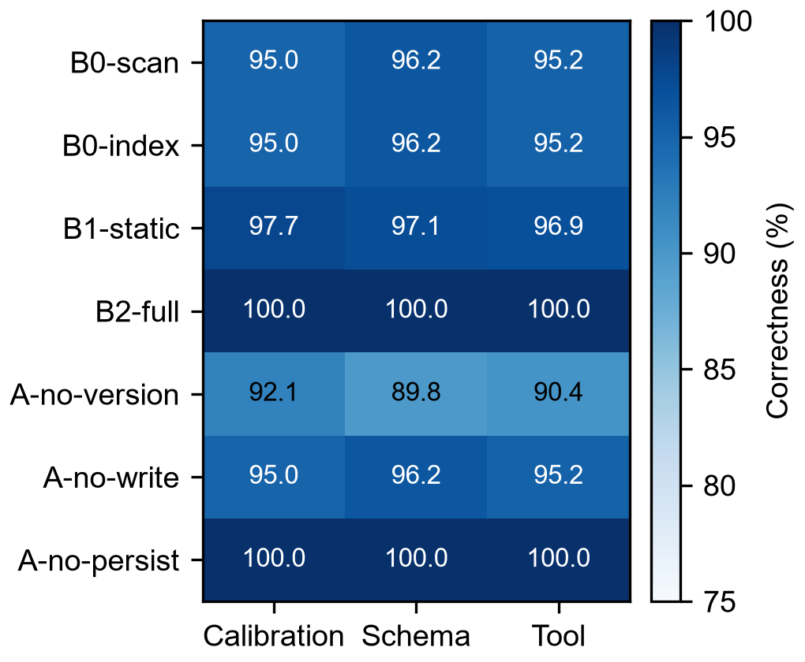
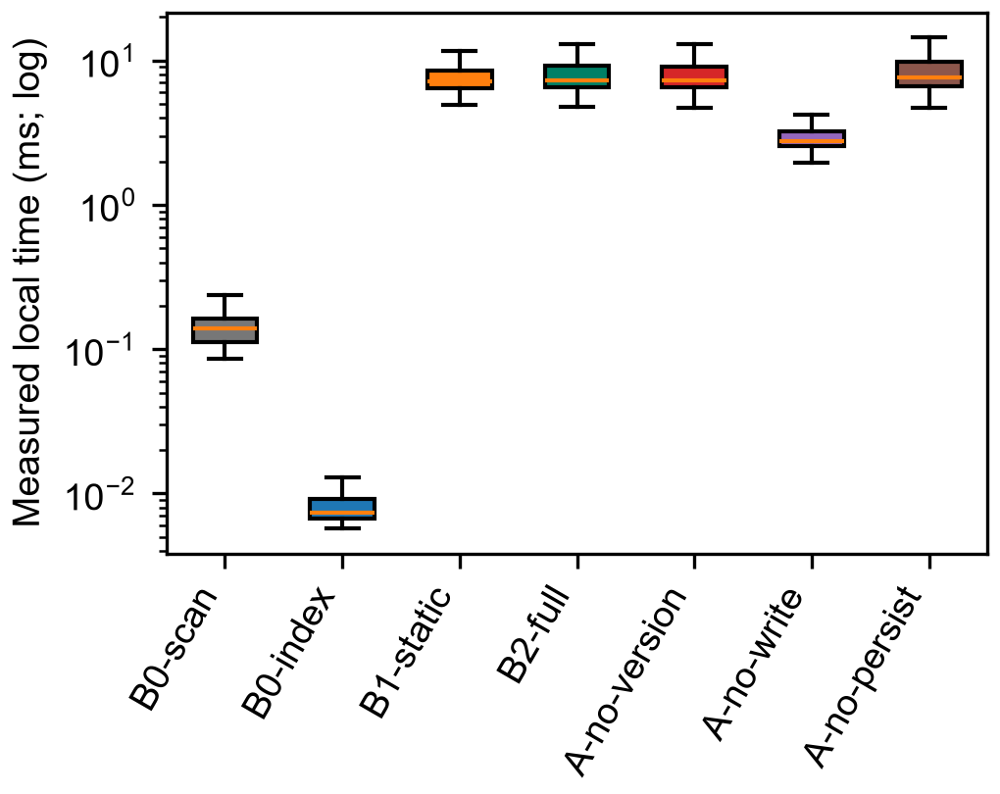
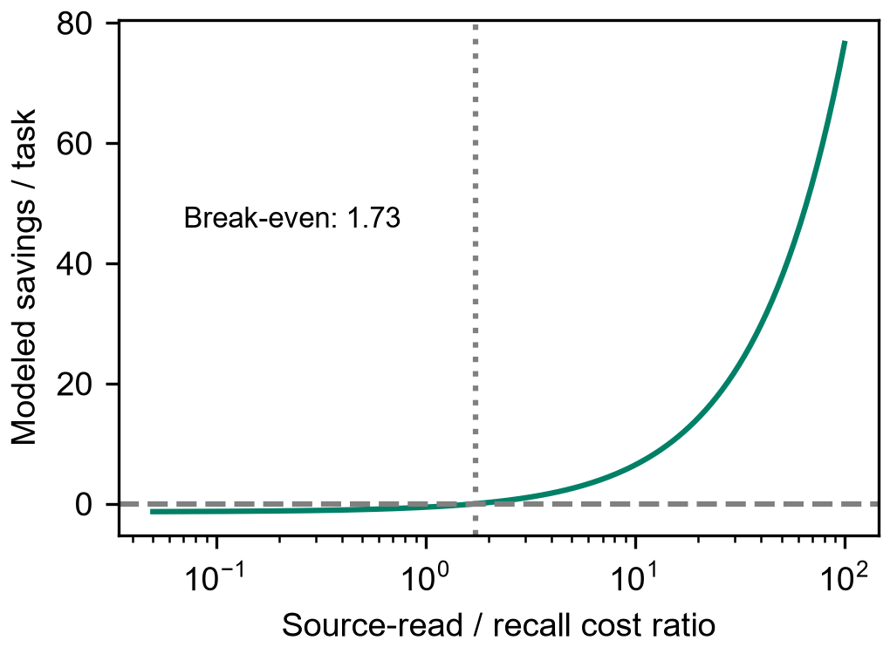
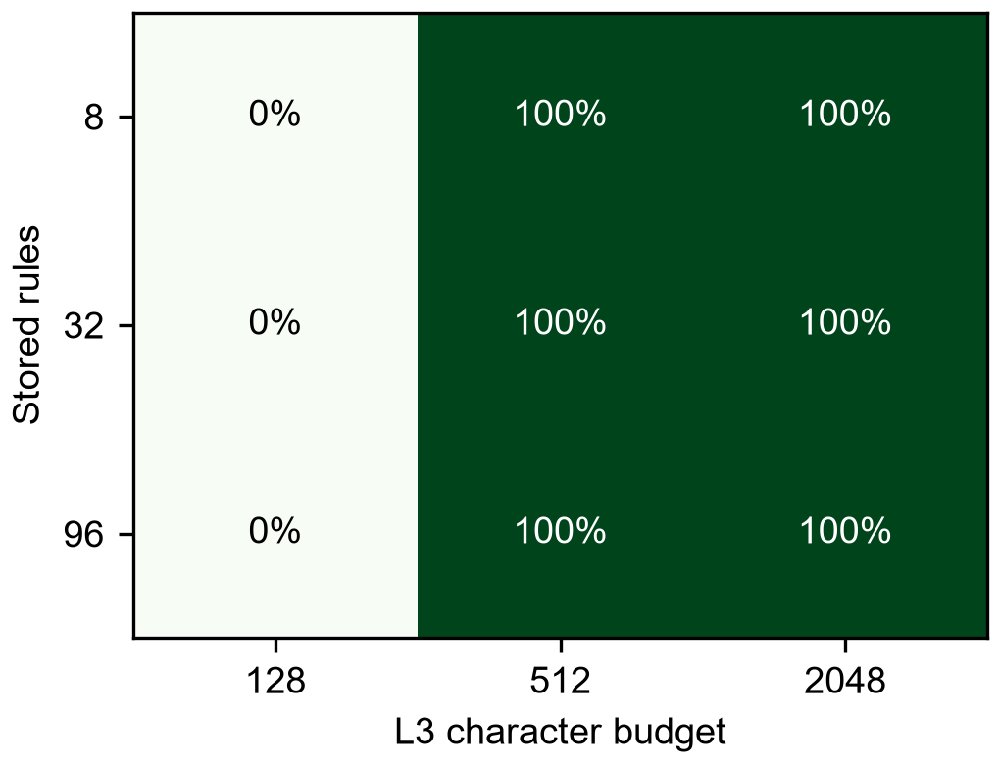

# 补天：面向宿主智能体的版本约束经验复用及其多轮收益评估

Butian: Version-Constrained Experience Reuse for Host Agents—A Longitudinal Mechanism Study

作者及单位：待作者填写。本文为中文 IEEE 风格研究稿；不代表已获 IEEE 接收，投稿语言、页数和作者信息须按目标会议确定。

**摘要—** 宿主智能体在连续处理同类任务时，既可能重复查阅已经验证的资料，也可能在版本变化后继续使用失效经验。仅比较单次检索命中，无法识别经验形成、变化适配和重启恢复的长期效果。本文研究补天的版本约束经验复用策略，将持久经验召回与宿主侧版本准入、来源回退及证据写回组合为闭环。我们使用同一确定性宿主求解器，在数值校准、字段迁移、工具参数适配三类合成契约任务上进行 10 个种子、12 轮、7 个条件的配对实验，共记录 10080 次执行。所有条件共享任务流、资料档案与反馈时序，并加入具有精确资料索引的强基线。完整策略完成 1440/1440 次任务，相对索引基线的 1375/1440 增加 4.51 个百分点，种子聚类自助法 95% 区间为 [3.68,5.35]；原始资料读取由 1375 次降至 253 次，减少 81.60%。去除版本检查产生 133 次过期经验错误；去除持久化增加 120 次资料读取。完整策略的逻辑操作总数比索引基线增加 41.53%，本地平均时延为 8.44 ms，未获得时延优势。结果支持限定任务分布内的经验复用和服务连续性收益，不构成大语言模型推理能力、幻觉率或参数进化的实证。

**关键词—** 智能体记忆；版本约束；经验复用；纵向实验；消融实验；可复现研究

## I. 引言

连续处理相似问题时，有用的经验不应只是上一题的答案，而应是可以迁移到新输入的规则、适用版本以及可追溯来源。例如，仪器读数的换算关系、数据接口的字段映射和远程工具的参数约定，都可能在短期内重复使用，也可能在固件或接口升级后失效。每次重新读取全部资料会产生重复工作，而直接信任历史经验又会把过期信息传入当前行动。外部检索能够补充参数之外的知识，但检索到相关内容与该内容适用于当前版本之间仍有距离。RAG 提供了非参数知识利用的经典路径[@Lewis2020]，LongMemEval 则把时间推理、知识更新和拒答纳入长期记忆评估[@Wu2024]。因此，本文关注的核心问题是：在相同求解能力和资料权限下，持续积累、版本约束及持久化分别对后续同类任务产生什么可测量的作用，而非笼统讨论记忆是否使模型更聪明。

此前的 24 个版本校准任务只比较固定经验与档案扫描，缺少随时间变化的任务流，也缺少能直接定位资料的强对照。这样的结果只能说明一次检索替代多次扫描，不能说明经验闭环在多轮环境中的稳定收益。本文把研究对象收敛为一个可复现的软件机制：同一个宿主求解器调用真实 ButianService.compose_context；来源可用时按同样权限获取规则，来源不可用时只能依靠此前验证并持久保存的规则。我们显式记录第一次作答、作答后的反馈与写回，避免将事后纠正计作首次正确。任务输入每轮变化，因此存储的是契约规则，而不是当前样本的答案。实验中的模型推理调用数为零；这种选择隔离了机制贡献，同时也限制了结论对自由文本任务的外推。

本文的贡献包括三个方面。第一，给出版本准入、来源回退、证据提交和服务重启组成的宿主侧经验策略，并区分生产召回接口与宿主使用策略的责任边界。第二，构造包含冷启动、随机版本漂移、资料间歇不可用和真实服务重启的多种子配对任务流，同时加入精确索引基线、静态经验基线和三种消融。第三，公开逐任务原始记录、实际上下文、版本链核验、图表生成脚本和种子级效应区间，并同时报告正结果与成本负结果。全文组织如下：第二节讨论相关研究，第三节形式化算法和收益边界，第四节说明实验协议，第五节分析多轮结果，第六节讨论理论解释与有效性威胁，第七节给出结论。

## II. 相关工作与研究定位

### A. 检索、长期记忆与经验反馈

检索增强生成在生成过程中利用外部文档，形成参数知识与非参数知识的结合[@Lewis2020]。MemoryBank 进一步讨论长期交互中的记忆保存、检索和更新[@Zhong2023]，LongMemEval 系统考察跨会话信息提取、时间推理、知识更新与拒答[@Wu2024]。这些工作为长期记忆评估提供了重要背景，但本文没有复现其原始语言模型或公开数据集，也不能把本文的合成契约正确率与其公开分数直接比较。本文把问题压缩为可执行规则的重复求解，以严格分离规则获得、规则版本、外部资料可用性和求解器能力。其价值是回答生产记忆路径是否减少重复取证、在什么条件下仍然失败，而不是替代开放域对话记忆基准。

Reflexion 利用任务反馈形成文字反思，强调通过经验改善后续行为[@Shinn2023]；Voyager 利用可扩展技能库进行持续任务探索[@Wang2023]。它们与本文共享“经验应服务后续任务”的动机，但本文没有调用反思模型，也没有复现自主技能生成。新经验的内容由可访问的合成源契约确定，契约的数值或字段只能在源可用时读取。错误反馈发生在首次答案记录之后，不能提前向任何条件透露正确规则。因而本研究更接近宿主经验基础设施的机制评估，其因果解释限于本实验中控制的策略差异；不能声称优于 Reflexion、MemoryBank 或其他完整智能体系统。

### B. 运行期适配与参数学习的边界

指令微调、基于人类反馈的强化学习和偏好优化直接改变模型训练过程[@Chung2022,Ouyang2022,Rafailov2024]；持续指令学习也需要训练协议及遗忘评估[@Scialom2022]。本文的数据库写入和上下文召回均没有修改模型权重，不能将运行期表现改善描述为参数自进化。TruthfulQA 和幻觉研究说明输出真实性需要特定任务、数据和判定标准[@Lin2021,Ji2022]；本文中的过期规则错误是精确可判定的软件输出错误，不是自由文本幻觉率。这个区别同时决定了本文的实验指标：首次正确、错误、unknown、资料访问、召回与写回次数、实际字符量以及本地耗时。任何关于模型规模、训练监督和涌现的解释均作为条件理论或后续假设单列，不进入本研究的实测贡献。

## III. 方法与算法分析

### A. 任务、经验与状态

在轮次 t，任务 x_t=(d_t,v_t,u_t,a_t) 包含实体、目标版本、新输入和来源可用性。经验 e=(d,v,r,E,l) 包含实体、适用版本、求解规则、来源证据和生命周期状态。宿主必须知道当前实体与目标版本；这是所有条件共享的任务信息，并非由经验系统预测。数值校准规则为 y=(x−b)/s；字段迁移规则将版本对应的两个源字段除以单位因子；工具规则生成版本对应的 endpoint、参数名和换算后的参数值。三类任务采用完全相同的版本检查框架，但输出形态分别是数值、字段对象和调用对象。字段、端点及比例因子变化均会改变后续输出，避免仅改变版本标签却未改变语义的无效漂移。

可用经验集合定义为：

$$A(x_t,M_t)=\{e\in M_t:d(e)=d_t,\ v(e)=v_t,\ e\text{可被上下文完整解析}\}.\tag{1}$$

本实验只在已验证源上写入 warm 经验，不测试 disputed 候选准入。完整策略首先召回上下文，只有获得唯一匹配的当前版本规则才允许直接求解；零匹配、冲突或预算截断都触发来源回退。来源不可用且无合法经验时返回 unknown。这里的版本检查由宿主解析器执行，compose_context 本身按权重、状态、相关性和字符预算提供候选上下文；本文不把宿主实现的准入规则归功于未实现的生产筛选功能。新经验通过 append_event 和 MemoryStore.put 写入，保留版本父链和证据引用。已有经验被替换时历史版本仍保留，服务正常关闭并重新打开后从同一路径恢复。

### B. 算法 1：版本约束的经验复用

```text
输入：任务流 X，持久库 M，源档案 S，L3 字符预算 B
对每轮、每个任务 x=(entity,version,input,availability)：
  1. C ← compose_context(host, entity, B)
  2. r ← 从 C 解析唯一 entity/version 匹配规则
  3. 若无 r 且源可用，则 r ← S 的精确版本索引查询
  4. 若仍无 r，则记录 unknown；否则记录首次答案 solve(r,input)
  5. 评测器在答案记录后检查结果；不向求解器提前透露真值
  6. 若首次错误且源可用，则重新读取源规则并记录反馈纠正
  7. 若本次获得源规则，则提交来源事件与经验版本；供后续任务使用
  8. 在规定轮次关闭服务；重新打开同一持久路径继续
输出：逐题答案、来源访问、实际上下文、写回和版本审计轨迹
```

上述步骤把决策时的可用信息与事后验证分开。新输入 raw 和字段值每轮重新生成，写入数据库的规则没有包含当前参考答案，因此重复命中属于规则复用。评测器可使用任务生成器保留的真值做评分，但不能直接把该真值写回；只有实际来源读取成功才能创建经验。首次错误即使在反馈后纠正，仍计为 wrong。关闭版本检查的消融与完整策略共享其他步骤，它会直接使用实体相同的旧规则，因而能够测量版本门控在首次决策上的作用。关闭写回的消融仍支付上下文查询成本，但没有长期规则可用；关闭持久化则只在重启后切换到空目录，不删除任何旧数据库。

### C. 收益分解与摊销条件

令 R 为源文档读取次数，Q 为上下文查询次数，W 为验证后逻辑提交次数，读取、查询、提交的单位代价为 c_s、c_q、c_w。一次逻辑提交实际包含一个事件追加与一次经验版本写入，并不等于一条 SQL、一次磁盘页写入或固定时长。总成本模型定义为：

$$C=c_sR+c_qQ+c_wW.\tag{2}$$

在源始终可用、规则不变且初次没有经验的 n 次重复任务中，理想索引基线读取 n 次源；完整策略需要 n 次召回、一次源读取和一次经验提交。因此：

$$C_{index}=nc_s,\quad C_{full}=nc_q+c_s+c_w.\tag{3}$$

$$C_{full}<C_{index}\iff n(c_s-c_q)>c_s+c_w.\tag{4}$$

若 c_s≤c_q，不能由重复次数增加推出成本收益。如果存在 d 次已检测的语义变化，且每次变化时资料可读，则源读取与写回上界变为 1+d；这反映了经验复用与规则漂移之间的竞争。资料不可用时，已有且版本匹配的经验可以增加任务覆盖，但没有合法经验的实体仍必须 unknown。把正确输出的价值纳入效用 U=V·N_correct−L·N_wrong−C 后，完整机制可能在成本更高时仍因连续性得到更高效用；但 V、L 和各单位成本不是本实验测量的价格，不能任意赋值后声称真实经济回报。

### D. 正确性不变量与复杂度

在源契约正确、源读取得到目标版本、宿主解析器和求解器正确、匹配经验未被破坏这些假设下，可以对任务序列归纳证明：完整策略每次非 unknown 输出来自当前源规则或此前保存的同版本规则。冷启动时只有源回退可以提供规则；归纳步中，匹配经验与源回退两条路径均保持版本一致，新写回仅保存已读取规则，因此不会引入旧版输出。该命题是条件正确性，不证明现实源文档永远正确，也不保证未经验证候选安全。记忆完整性通过实际版本链审计核对，而不是用该证明替代执行。若版本标识不变但语义已变，假设被破坏，系统仍可能返回错误，必须另加内容指纹或漂移观测。

设经验数量为 M、输入查询词数为 L、上下文预算为 B、源档案大小为 N。当前生产召回使用 OR 连接的 LIKE 匹配并最多取 8 个候选，不能无证据宣称近似向量索引的对数复杂度；保守地把未索引匹配成本写为 O(ML)，上下文构造受候选数和 B 约束。全档案扫描为 O(N)，实验中的理想索引基线抽象为一次精确版本访问，未测量构建索引成本。SQLite 事务、审计和服务维护会增加固定开销，这正是应当报告实际耗时的原因。预算低于完整规则所需字符时，召回“相关”仍可能无法执行；本文通过敏感性实验观察这一边界。

## IV. 实验协议

### A. 研究问题与任务流

RQ1：经验形成后，后续轮次是否减少原始资料读取，并在规则变化后及时恢复？RQ2：资料暂时不可用时，当前版本经验是否提高首次任务完成率？RQ3：版本检查、写回与持久化各自贡献多少？RQ4：这些收益是否同时带来操作数或本地时延优势，以及上下文预算如何限制它们？主实验采用 10 个固定种子 [1103,2207,3301,4409,5519,6619,7723,8837,9941,10151]，每个种子包含 3 类任务各 4 个实体，共 12 个实体，连续执行 12 轮。每轮每实体一个新输入，得到 144 个任务/种子、1440 个配对任务；七个条件共 10080 次首次执行。各条件使用独立经验库，但共享完全一致的输入、档案、版本号及来源可用性。

第 1 轮为无经验冷启动，第 2—4 轮复用；第 5 和第 9 轮各对实体独立以 0.5 概率更改语义规则，并增加版本；第 6—7 轮对每个任务以 0.25 概率令源不可用；第 8 轮真实关闭并重开服务。每次漂移都检查排除“语义参数未变”的规则。档案初始包含 12 个有效契约和 12 个干扰契约，每次漂移追加历史版本，不覆盖旧记录。条件执行顺序按种子、轮次和题序循环平衡，避免某一方法固定先执行；它不是完全随机盲测。用于设计调试的 5 种子固定日程 pilot 结果保留在原目录；主实验 r2 协议在运行前写入，明确注明 pilot 已存在，因此不是未经探索的预注册研究。

### B. 对照条件与消融

| 条件 | 源回退 | 经验形成与变化 | 目的 |
|---|---|---|---|
| B0-scan | 扫描全部档案 | 无经验 | 展示扫描成本上限 |
| B0-index | 一次精确版本定位 | 无经验 | 主要强基线 |
| B1-static | 同一精确索引 | 仅第 1 轮写入；版本检查保留 | 分离静态与持续经验 |
| B2-full | 同一精确索引 | 全程证据写回；版本检查；持久化 | 完整宿主策略 |
| A-no-version | 同一精确索引 | 去除宿主版本准入，保留反馈写回 | 测量过期经验误用 |
| A-no-write | 同一精确索引 | 查询经验但禁止写回 | 测量经验积累 |
| A-no-persist | 同一精确索引 | 第 8 轮使用空库，其余相同 | 测量重启重复工作 |

B1 在第 1 轮通过真正读取来源形成记忆，不能预先获得答案；其后固定不再更新。所有实验条件若召回失败都能使用同一精确索引，只有 B0-scan 按定义读取全部档案。将 B0-index 列为主要基线，避免用有意低效扫描夸大实际成本收益。A-no-version 即使被评测器判错也先保留首次错误，随后只有源可用才可以修复；这避免把取消错误答案或事后覆盖当作正确率提升。A-no-persist 的失忆由切换到新目录实现，原数据完整保留。主实验的重启发生在源恢复后，因此它主要测量重复查询成本，没有检验“失忆与断源重叠”的最坏情况。

### C. 指标、统计与可复现性

主要质量指标为首次正确率 N_correct/N；unknown 单列为未完成而非错误断言，条件正确率 N_correct/(N−N_unknown) 同时报告。资料读取 R、召回 Q、验证提交 W 分开统计，R+Q+W 只是逻辑次数，不能等同于磁盘 I/O、token、金额或时延。另记录实际源字符数、完整上下文字符数和 perf_counter 本地耗时；字符数不是语言模型 token。源档案在内存中表示，资料读取是被检查的逻辑文档数；B0-index 的代价是理想索引定位，时延不能外推为真实文件、网络或人工查阅时延。生产记忆库为真实 SQLite 服务路径，记录 compose_context 原文和实际返回的经验编号。

对每个种子计算 B2 与对照的首次正确率差及操作数相对差，再以种子为聚类单位重采样 10000 次，报告百分位 95% 区间。10 个种子才是独立任务流，1440 题不是 1440 个用户或独立模型。由于各流任务数相同，正确率差的种子均值与总体差相同；操作数相对差的种子均值则一般不等于汇总比值，二者分别标记。未对所有消融进行多重检验后的显著性声明。预算敏感性另外使用 3 个种子、8/32/96 条规则和 128/512/2048 字符预算，每组合查询 8 个实体，共 216 次查询；该部分不计入主实验任务数，不用于宣称大规模泛化。

## V. 结果与分析

### A. 总体结果及来源访问收益

| 条件 | 首次正确/1440 | 错误 | unknown | 源读取 R | 召回 Q | 提交 W | 逻辑合计 |
|---|---:|---:|---:|---:|---:|---:|---:|
| B0-scan | 1375 | 0 | 65 | 42287 | 0 | 0 | 42287 |
| B0-index | 1375 | 0 | 65 | 1375 | 0 | 0 | 1375 |
| B1-static | 1400 | 0 | 40 | 752 | 1440 | 120 | 2312 |
| B2-full | 1440 | 0 | 0 | 253 | 1440 | 253 | 1946 |
| A-no-version | 1307 | 133 | 0 | 253 | 1440 | 253 | 1946 |
| A-no-write | 1375 | 0 | 65 | 1375 | 1440 | 0 | 2815 |
| A-no-persist | 1440 | 0 | 0 | 373 | 1440 | 373 | 2186 |

完整机制首次正确率为 100%，索引基线为 95.49%，静态经验为 97.22%，无版本检查为 90.76%。索引基线的 65 次未完成全部是源不可用时的 unknown，不能称为 65 次错误回答；其非 unknown 输出条件正确率仍为 100%。因此 B2 相对该基线的 4.51 个百分点是资料中断条件下的完成率增益，没有证明源可用时它比确定性求解器更准确。B2 共有 1187 次规则复用命中，占 82.43%；253 次源读取恰好对应 120 次冷启动与 133 次版本变化后的首次刷新。相对 B0-index，源读取减少 (1375−253)/1375=81.60%；相对 B0-scan 的差异更大，但后者不是本文主要收益依据。

### B. 多轮积累、漂移与连续性


图 1. 逐轮首次正确率（上）与每任务源读取（下）。虚线为第 5、9 轮漂移，阴影为第 6—7 轮源间歇不可用。各点为同轮 120 个任务的描述性均值；非独立轮次。


图 2. 每种子平均累计源读取。B2 冷启动后进入平稳复用，变化时增加刷新，重启后延续原有经验；失忆消融在第 8 轮增加重复读取。

第 1 轮所有方法均从空经验状态开始，没有预填正确答案。第 2—4 轮中完整机制和静态经验都能复用，因而仅凭该阶段无法区分两者。第 5 轮发生 70 次规则语义变化，第 9 轮发生 63 次；完整机制拒绝旧版本后各读取一次当前源，首次作答仍正确。关闭版本检查分别产生 70 和 63 次错误，随后在源可用的同一轮修复；下一轮不再重复。因此该消融说明版本准入避免了变更边界的首次错误，但不能宣称当前实验观察到无限期错误复发。静态经验对新版本始终无法形成可用规则，从而在后续轮次重复读取，图 2 的曲线与完整机制逐渐分离。

第 6 轮索引基线完成 99/120，第 7 轮完成 76/120，完整机制两轮均为 120/120；静态经验分别为 108/120 和 92/120。完整机制能在这些任务中继续工作，是因为第 5 轮源仍可用，当前规则已经被实际读取并提交，而非系统获得了不可访问的新知识。若版本变化与源中断同时发生，完整机制在没有当前版本经验时也必须 unknown，本实验未声称解决这种不可识别情况。第 8 轮服务重启后，B2 没有新增源读取；A-no-persist 则为每实体重新读取，共增加 120 次。该失忆消融最终正确率不变，因为此轮源已恢复，它证明持久化减少重做，而不是证明任何时刻重启都无风险。

### C. 消融、任务族与配对区间



图 3. 三类任务的首次正确率。每条件每类 480 次。任务族共享契约框架，因此不是三个独立行业数据集。


图 4. B2 相对主要对照的首次正确率差及种子聚类自助法 95% 区间。

数值校准、字段迁移和工具适配的 B2 正确次数均为 480/480；索引基线分别为 456、462、457；无版本检查分别为 442、431、434。三类输出形态下都能观察到复用与版本准入作用，但实体和规则全部由实验生成，不能将其视作真实工业用户样本。B2 对 B0-index 的种子均值增益为 4.51 个百分点，95% 区间 [3.68,5.35]；对 B1-static 为 2.78 个百分点，[2.08,3.47]；对 A-no-version 为 9.24 个百分点，[8.33,10.14]。这些区间反映固定生成过程下种子变化带来的不确定性，不包含任务族选择、求解器设计或源质量误差。

去除写回后，经验命中始终为零，资料读取恢复为 1375 次，并在资料中断时出现与索引基线相同的 65 次 unknown。它比 B0-index 多支付 1440 次无效召回，说明“调用记忆工具”本身不构成有益经验积累。去除持久化后总逻辑次数由 1946 增为 2186，完整策略对该消融的汇总节省为 10.98%，种子级平均操作数节省为 10.98%，95% 区间约 [10.85,11.13]%。无版本检查与完整机制的源读取和写回数量相同，但首次正确率不同，表明只看检索命中率或总成本会遗漏过期规则误用。完整策略审计了 480 条实际记忆版本链，编号、父链和当前内容一致；该核验不涵盖真实进程崩溃事务恢复。

### D. 成本、时延与适用阈值


图 5. 每种子逻辑操作数构成，纵轴对数。三类操作的单位成本不同，堆叠总量仅作记账对照。



图 6. 本地每任务耗时分布（对数轴；箱线图省略离群点显示，原始值保留）。不包含模型推理、网络或人工查阅。

源读取减少不能自动推出总操作数减少。完整策略为 1946 次逻辑操作，索引基线为 1375 次，汇总增加 41.53%；按种子平均的相对增加为 41.57%，其区间约 [39.01,44.15]%。完整策略相对静态经验的汇总逻辑节省为 15.83%，种子均值为 15.80%，95% 区间 [14.99,16.81]%；相对全档案扫描的汇总节省约为 95.40%，但该值高度依赖扫描档案大小。完整策略本地平均耗时为 8.440 ms，索引基线为 0.010 ms，静态经验为 7.814 ms。前者包含真实 SQLite 召回和审计写入，而后者为内存中的理想索引抽象，当前数据清楚地否定了“补天在本地简单索引任务中更快”的表述。



图 7. 单位代价假设下的模型节省：令 c_q=1、c_w=2，横轴为 c_s/c_q，阈值约 1.73。该图是解析敏感性分析，不是实测金额或网络时延。

使用式（2），B2 相对索引基线节省成本的必要比较为 1122c_s>1440c_q+253c_w。在假设 c_q=1、c_w=2 时，源读取的单位成本需超过约 1.734 才有正的代价差。该阈值明确表示只有源资料读取足够昂贵，复用才可能抵消维护支出；如果源规则可以廉价直接定位，经验基础设施主要提供的是资料中断连续性和审计能力。本地上下文共 472688 个字符，源字符数为 28214，而索引基线源字符数为 152663。二者相加后 B2 更大，故也不能声称已经减少模型输入 token。原始上下文、源字符和耗时均已公开，方便后续在实际宿主调用边界测量真实成本。

### E. 上下文预算敏感性



图 8. 216 次额外查询中，可完整解析且版本匹配的规则命中率。每格 3 个种子各 8 次查询。

在 8、32、96 条已验证规则三种规模下，L3 预算 128 字符时均无法完整容纳目标规则，命中为 0/24；预算 512 或 2048 时均为 24/24。该现象说明返回相关记忆编号并不等于上下文包含了可执行经验，预算截断必须进入机制评估。小规模精确实体词查询在扩大规则数量后没有失效，不能据此声称支持百万级经验或自然语言歧义召回。实验未同时加入大量同名候选、低质量规则、跨实体冲突或对抗干扰，这些场景可能导致不同的候选竞争。完整策略在预算不足时仍需回退源；敏感性部分仅评估召回完整性，不把零命中直接计为最终任务失败。

## VI. 讨论、理论联系与有效性威胁

### A. 闭环作用与参数信息容量

主实验支持的闭环是“读取有效规则—附来源写入—后续召回—当前版本准入—变化后刷新—持久恢复”，而不是“使用次数自动产生正确知识”。任务流的正确源和已知版本是关键条件；如果同一错误源被反复确认，数据库中的使用次数增长并不能纠正错误。设离散隐藏规律 H 通过训练文本 T 编码到有限表示 Z，数据处理不等式给出 I(H;Z)≤I(H;T)。若表示容量为有限 b 位，则 I(H;Z)≤b；在 H 均匀分布于 M 个候选且满足相应识别条件时，Fano 型界给出 P_e≥1−(I(H;Z)+1)/log₂M。它说明有限信息容量可以限制隐藏规律识别，并不证明参数量单独决定理解率，也不证明某个具体小模型“犟”必然源自信息丢失。本文没有测量模型参数或内部表示，相关理论只用于约束可能解释。

模型大小、表示精度、数据质量、优化过程、任务分布和推理预算都会改变可保留及可用的信息；扩大参数只有在有效编码和训练条件下才可能增加容量利用。小模型在部分任务上表现良好，可以与“只保留了任务相关规律”的压缩解释兼容，也可能来自更合适的数据、训练目标或提示，现有实验不能排除这些因素。相似地，本文源契约规则十分短小且求解器已具备解析能力，任何一组都不需要学习新的思维方式。将该机制实验包装成参数规模理论的验证会越过证据边界；因此本稿把信息论命题与机制结果明确分离，而把原有更广泛理论材料保留为补充研究文档。

### B. 监督质量、涌现与持续进化

关于监督与输出真实性，可以把独立二元标签正确率设为 p>1/2；在独立、同分布及多数表决前提下，错误概率可由 Hoeffding 型界随样本数指数减小。若标签具有系统偏差或高度相关，该前提失效，增加数量可能重复放大同一错误。RLHF、指令微调和偏好优化提供不同训练约束[@Ouyang2022,Chung2022,Rafailov2024]，不能仅凭资料数量推断它们的幻觉改善。本文 no-version 产生的 133 次错误直接源于已观测的旧规则准入，是真实机制反例；它并不估计训练文本质量对语言模型幻觉率的因果效应。可用经验增长必须建立在准确来源、相对独立反馈、内容去重和审核之上，使用次数本身不是知识质量的充分统计量。

对于涌现，可以区分连续潜在能力随训练变化与离散评测阈值造成的跳变，也可以提出文本学习了程序或思维规则的解释；两者并不互相排除。本文的逐轮复用曲线来自已知规则被写入数据库后的可访问性变化，不是神经网络新能力涌现。系统层面的持续适配可以在模型权重不变时发生，当前实验确实观察到了该层收益；若要把经验用于后训练，还需要构造带来源和反例的训练样本、分离训练测试实体、进行真实参数训练并评估保持率和遗忘[@Scialom2022]。这些步骤没有在本研究发生，因此“可以提供后训练候选数据”与“已经证明参数自进化”必须分开陈述。

### C. 内部、外部与构念有效性

内部有效性主要受确定性求解器和共享生成规则影响。我们通过同题配对、统一来源权限、首次答案冻结、条件执行顺序平衡以及真实生产召回减少混杂，但评测仍由研究者设计并执行，不是独立第三方盲测。10 个随机种子只能刻画当前生成器，不能消除生成器本身的偏好；pilot 先于主协议的事实已公开，没有事后隐藏失败条件。版本链一致核验和配对输入核验降低了实现与数据整理错误的风险，但没有证明所有生产功能正确，也未进行崩溃、真实 MCP 断连和跨平台全量安全评估。本文未改动业务内核以追求分数，实验的宿主策略均在研究脚本中实现。

外部有效性受三类任务共享实体、版本、契约形式限制。本文没有真实用户、开放域语言问题、多模型或随机解码实验；因此不能把 100% 合成正确率解释为真实宿主智能体成功率。工具适配任务只构造调用对象，未发送真实远程请求；字段迁移使用可执行对象比较，未覆盖复杂语义映射。正常重启验证不等于崩溃恢复。源中断发生在规则刷新之后，容易体现缓存的可用性价值，却不能覆盖未知新规则与断源重叠的困难条件。未来实验应在同一宿主 Agent 内冻结任务、记录真实工具调用，按完整任务流配对统计，同时保留 unknown 和人工核验成本。

构念有效性要求严格区分正确率、覆盖率、资料读取和总资源。unknown 不算错误断言但降低完成率；一次 SQLite 查询不能和一次网络文档下载等价；字符数不等于 token；本地延迟不等于含模型推理的端到端延迟。本文在图表中明确指出这些差别，并用式（2）把假设代价与实测次数分开。算法收益因此不是一个普遍常数，而是任务复用频率、版本变化率、来源成本、源可用性以及召回维护成本共同决定的结果。对这类宿主经验系统，正式论文应同时提供收益成立的条件和不成立的对照，否则单一访问下降百分比会掩盖代价转移。

## VII. 结论

本文给出了补天版本约束经验复用的算法、条件正确性和摊销成本模型，并通过 10 种子、12 轮、7 条件的 10080 次执行检验其在三类同构任务中的作用。完整机制把原始资料读取从强索引基线的 1375 次降为 253 次，在已有当前规则且源中断时多完成 65 次任务；版本准入避免了 133 次旧规则首次误用，持久化减少了重启后的 120 次重复读取。与之同时，总逻辑操作数增加 41.53%，本地耗时也更高，故当前机制收益集中于规则复用、变更正确性和资料中断连续性，不能概括为普遍加速或模型能力进化。可复现材料保留全部对照和负结果，后续应在同一真实宿主 Agent 的多轮问题解决过程中测量端到端工具调用、上下文输入、人工复核和真实成本。

## 可复现材料

主结果目录：experiment_results/multiround-ieee-20261015-r2/。run_multiround_study.py 生成任务、逐题结果、上下文和审计；plot_multiround_study.py 从原始记录生成八幅图及 round-summary.csv，并核验输入配对、首次决策、冷启动、禁写和版本链。复现时必须指定新的输出目录，避免覆盖已有数据。主实验包含 1440 个配对任务、10080 次条件执行，另有 216 次预算查询；生产数据库不纳入 Git，逐题 JSON 和上下文轨迹纳入。脚本摘要、基础提交、Python 与平台保存在 environment.json；manifest.json 校验原始 JSON，delivery-manifest.json 另校验图表及分析产物。

## 参考文献

参考文献由检索结果生成，按正文首次出现排序，采用 IEEE 数字编号；完整元数据见 references/ieee-study-references.json。不引用检索中的无关命中。中文稿的作者、单位、目标会议和投稿语言仍需作者确定。
