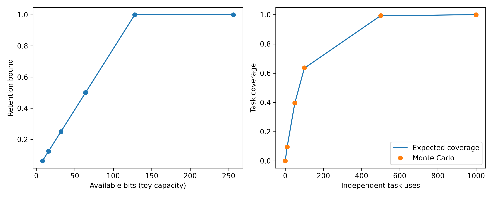

# 补天：依附宿主智能体的经验生命周期、证据约束与上下文恢复

内部研究论文草稿，2026-10-15。研究对象为 butian_plan 0.1.3；代码基线为 6be9552df1df4ee64da199d99aaf40c191ea8fa0。本文报告数学推导、数值控制和已有工程验证；已保存15条当前Agent同会话非盲测条件回答；该记录没有隔离模型内部上下文，不能等同受控消融。

## 摘要

长程智能体容易把一次成功扩展为普遍规律，把外部文献主张直接当成自身经验，并在上下文压缩、版本变化与执行取消之后丢失任务状态。本文研究一种依附宿主 AI 应用的经验管理方法，将经验表示为带来源、环境、版本、证据和失效条件的候选对象，通过实践记录、冲突记账、审核、证伪与恢复形成生命周期。本文给出加权 Beta 更新、期望信息价值、目标总体标准化和预算选择的形式化论证，并使用生产数学模块执行数值控制实验。80 个后验分位数检查与 SciPy 参考实现一致，200 个八选项预算实例与穷举最优值一致；三种随机种子下的二元 Thompson Sampling 仿真分别有 992、994、985 次选择高收益臂。五类任务隐藏参考的数值部分得到复算，研究和数学专项测试共 19 项通过。以上结果支持限定输入上的数值实现一致性，不能证明补天提高宿主模型的任务成功率。预先定义的 B0/B1/B2、五类任务、三种种子共 45 个模型输入仍属于待执行协议，本文明确保留模型效果、成本与跨平台推广的证据缺口。

关键词：语言智能体；经验生命周期；证据约束；贝叶斯更新；上下文恢复；可复现实验

## 1 引言

智能体长期运行的困难不只在于保存更多文本，还在于辨认哪些文本可以支持当前行动。某次成功可能依赖特定固件、量纲、工具参数和操作顺序；当环境改变时，旧记录既可能提供有效迁移，也可能诱发错误。补天把记忆检索与经验有效性分开处理：检索只产生候选，候选进入行动还需要来源、版本和当前任务条件的核验。系统依附宿主应用提供的模型和会话，不要求另接模型服务。本文的研究问题是，经验生命周期与证据约束能否构成清晰、可检验的工程机制，以及这些机制的数学辅助组件在限定条件下是否正确。至于该机制能否改善实际模型行为，需要同一宿主Agent运行与配对分析，不能由软件单元测试推导。

本文贡献有三项。第一，给出经验候选、证据更新、失效、冲突和上下文恢复的统一工作定义。第二，整理数学模块的命题与适用条件，尤其区分后验置信度、事实真值、单次熵变化和期望信息增益。第三，提供带代码基线、种子、结果与文件哈希的可复现数值控制，并保留未执行的模型实验协议。论文不是第三方审计报告，结果来自本项目内部运行；既有发行回归和本次研究实验也分别记账。

## 2 相关工作与研究定位

文献检索记录位于 references/references.json。检索结果包含明显无关论文，本文只选取相关条目，全部原始记录保留。AgentCL（Shu 等，2026）以语言智能体持续学习评价为主题；Auto-Dreamer（Ye 等，2026）和 Self-Consolidation（Yu 等，2026）关注离线记忆整合与自演化；Get Experience from Practice（Feng 等，2025）讨论记录与重放。本文引用这些检索所得主题作为研究定位，不据此宣称其具体实验结论已复现。补天当前能够支持经验记录与恢复的工程链路，但没有运行这些论文的公开基准，也没有完成同等规模的模型对照。

主动学习方面，Houlsby 等（2011）的贝叶斯主动学习研究提供了以信息量选择观测的背景。人类记忆方面，Tulving（1983）的情景记忆、Howard 与 Kahana（2002）的时间上下文表征，以及 Godden 与 Baddeley（1975）的情境依赖记忆提示了来源和上下文的重要性。本文把这些思想转为工程假说：恢复时应携带当前 revision、证据来源和执行状态，而不是仅恢复一段摘要。这种类比没有建立人类心理机制与软件状态机的同一性；系统有效性仍须通过可观测的恢复结果检验。

## 3 形式化对象与系统机制

经验对象记为 e=(h,s,v,c,E,l)，其中 h 为可证伪的主张，s 为来源，v 为版本，c 为适用条件，E 为证据集合，l 为生命周期状态。外部论文主张首先进入 practice_hypothesis；本地工具执行、结果复核和审核形成新的证据，不允许仅凭引用自动转成稳定经验。冲突记录保留两个主张的来源与条件，在信息不足时返回 unknown。这里 unknown 是证据状态，不是失败的委婉表述。版本链用于追溯主张变化，上下文恢复则需要任务、计划 revision、工具执行记录和当前可确认状态相互一致。

生命周期的候选转移由显式分数归一化产生。若候选集合 C 中每个分数 z_j 非负且总和大于零，则 P(j)=z_j/Σz_k。此分布只表达调用者提供的候选偏好，不自行推导合法状态边，也不构成已经训练好的马尔可夫模型；当前参数 current 与 evidence 不能被解释为经验学习所得的转移概率。停止语义同样必须独立处理：提交取消请求只说明意图，未确认进程退出时应保留 unknown，不能把请求成功当成停止成功。

## 4 数学模型与论证

### 4.1 加权 Beta 更新

设先验 α>0、β>0，证据质量 q、独立性 d、环境匹配 m 均属于 [0,1]，有效权重 w=qdm。成功更新 α'=α+w，失败更新 β'=β+w。只要 w>0，新参数仍严格为正，Beta 分布合法。后验均值为 μ=α/(α+β)。成功更新的变化为 Δμ=wβ/[(α+β)(α+β+w)]≥0；固定失败参数并重复等权成功时，分母递增，边际变化递减。失败更新对应 Δμ=−wα/[(α+β)(α+β+w)]≤0。零权重在当前接口中被拒绝，因此“忽略证据”应由调用者跳过更新。

整数、独立的 Bernoulli 观测满足传统共轭解释；分数权重等价于加权似然或幂似然的工作模型，不能自动继承真实数据生成过程的校准保证。q、d、m 的乘积也不自动解决重复证据识别：若同一记录重复提交且 d 均设为 1，模型仍会人为增加证据强度。因此来源去重和独立性评估属于上层责任。95% 等尾后验区间由 Beta 分位数给出，与频率学派 Wilson 区间的覆盖语义不同。

### 4.2 熵与期望信息增益

对互斥、完备状态 S，H(p)=−Σ p_i log₂p_i。设观测 Y 的概率为 r_y，条件后验 p(i|y) 归一化，并满足完整混合恒等式 Σ_y r_y p(i|y)=p_i，则 EIG=H(p)−Σ_y r_y H(p(·|y))≥0。证明：熵为凹函数，对后验混合应用 Jensen 不等式即可；等价地，EIG 是联合分布与边缘乘积之间的 KL 散度。这个证明必须有完整一致性，逐元素检查 r_y p(i|y)≤p_i 只是必要约束，不足以代替混合恒等式。

当前 expected_information_gain 实现检查归一化、逐元素必要约束和最终熵差，但未完整检查后验长度与混合恒等式。本文实验仅使用完整一致的二元完美观测模型，不对任意输入声称实现严格互信息。单次观测的 H(prior)−H(posterior) 可以为负；当前 information_gain 拒绝这类输入，是“只接受熵减候选”的工程约束，不是贝叶斯理论要求每个观测都降低熵。动作分数 IG−λcost 同样是给定权重下的工作排序，不能保证最优长期策略。

### 4.3 分层效果与可识别性

对层 k，描述性差值 δ_k=mean(Y_T,k)−mean(Y_C,k)，目标总体权重 π_k≥0 且 Σπ_k=1，标准化差值 δ=Σπ_kδ_k。线性展开得到 δ=Σπ_k mean(Y_T,k)−Σπ_k mean(Y_C,k)，因此处理与对照使用相同目标总体，避免把组间不同样本构成误当效应。目标权重改变时 estimand 也改变，不能暗中换为等权或样本量权重。difference_in_means 返回的类名虽含 CausalEstimate，若没有随机分配、可交换性、正值性和一致性等识别条件，结果只能称描述性差异，不能称因果效应。

### 4.4 区间与小样本边界

Wilson 区间通过反解二项比例的 score 不等式得到；对 n>0，即使全成功或全失败也不会退化为零宽度区间。Student t 均值区间为 x̄±t_(0.975,n−1)s/√n，其精确覆盖依赖独立同分布正态样本；偏态、相关数据和自适应采样需要另行分析。n=1 时样本标准差及自由度为零的 t 区间均无定义，数据字典要求 null。三个种子并不等于三个同一宿主Agent；同一会话依次运行 B0/B1/B2 的污染也不能靠计算区间修复。

### 4.5 预算选择与排队边界

设选项 i 的净效用 u_i=quality−cost−risk，成本 c_i≥0，预算 B≥0，求 max Σu_ix_i，约束 Σc_ix_i≤B、x_i∈{0,1}。动态前沿从空集开始，每轮保留不选和可行选择；若状态 A 的成本不高于 B 且效用不低于 B，删去被支配状态不会损失后续最优解，因为后续可加入集合相同且效用可加。由归纳可知算法在未触发 100000 状态上限时保留一个最优可行解。该结论依赖选项独立、效用可加；工具依赖、互斥和协同收益不在模型内。状态上限意味着可能显式报错，不能称任意规模均可求解。

利用率 ρ=λ/μ 在标准单服务台平稳模型中用于稳定性判断。ρ≥1 提示长期负载风险；ρ<1 不保证某次任务的响应时延，也不能排除重尾服务时间或瞬时拥塞。Thompson Sampling 对每个二元奖励臂维护 Beta 参数并采样选择；本文没有证明其在非平稳智能体工具环境中的收益界，也没有把生成文本质量直接当作 Bernoulli 奖励。

## 5 实验设计

执行脚本为 run_mechanism_experiments.py，结果目录为 experiment_results/math-controls-20261015。实验类型固定为 mechanism_control，actual_model_runs=0。实验使用生产数学模块，SciPy 为独立数值参考，穷举为小规模组合优化参考。脚本记录代码 commit、Python、OS、随机种子，并生成结果 JSON、CSV、300dpi PNG 与 SHA256 清单。运行时不访问宿主模型、网络或身份凭据。原始文献和既有数据均保留，研究结果目录拒绝覆盖。

实验一在 q∈{0.1,0.25,0.5,1}、d=m=1 下进行 20 次连续成功更新，比较每一步等尾区间与 SciPy beta.ppf，容差为 10⁻⁹。实验二用固定种子生成 200 个八选项预算实例，比较稀疏前沿与全部 256 个子集的最优值，容差为 10⁻⁹。实验三在奖励概率 0.3 与 0.7 的两个平稳独立臂上，以三种种子各运行 1000 步。另以完美二元观测核验 1 bit 信息增益，并检查 λ∈{2,4,6}、μ=4 的负载边界。任务参考复算包含压力换算和五样本 t 区间；版本和恢复值只作为显式参考记录，不是执行器行为验收。

预注册模型协议包含 B0 当前会话、B1 固定记忆检索、B2 完整机制；五类任务和三种种子形成 45 个同Agent条件运行。实际执行使用同一个宿主Agent，轮换B0/B1/B2顺序，保存宿主、模型版本、条件顺序、上下文携带、预算、事件、评分与缺失成本。该协议尚未执行，本文没有提供B0/B1/B2比较表，也没有将确定性控制改写成语言模型答题结果。

## 6 结果

| 控制项目 | 实际数量 | 观察结果 | 解释范围 |
|---|---:|---|---|
| Beta 区间参考比较 | 80 | 全部绝对误差小于 10⁻⁹ | 选定参数网格 |
| 预算穷举比较 | 200 | 全部最优值误差小于 10⁻⁹ | 八选项、可加效用 |
| 完美二元观测 | 1 | EIG=1 bit | 一致的合成模型 |
| 负载边界 | 3 | ρ=0.5/1/1.5 | 阈值分类 |
| Thompson 仿真 | 3×1000 步 | 高收益臂次数 992/994/985 | 平稳二元合成环境 |
| 研究与数学专项测试 | 19 | 全部通过 | 指定测试集 |
| 同一宿主Agent实际运行 | 0 | 未执行 | 不提供模型效果结论 |

Thompson 三轮奖励总数为 678、727、724，不能把单个种子的奖励差异解释为机制优势；本次没有与均匀探索作配对比较。source_practice 复算均值 3、样本标准差 1.5811388300841895、自由度 4，95% 区间为 [1.0367568385224428,4.963243161477557]，与任务参考在浮点误差内一致。压力复算为 3400 Pa 与 1700 Pa=1.7 kPa。Beta 敏感性图说明低有效权重使相同次数成功对应更弱的均值变化，这只是公式行为，不是实际证据质量已经正确识别。

已发布 0.1.3 的工程回归记录为 946 passed、1 skipped、0 failed，属于前一阶段发行证据；本次未重新执行完整发行回归。该记录验证功能路径，不估计模型收益，也不等同第三方审计。

## 7 讨论、局限与后续验证

数值控制降低了公式实现错误与小规模优化错误的风险，但没有测量经验检索对语言模型的净贡献。合成数据完全满足预设模型，真实工具反馈则可能相关、延迟、含噪且跨版本变化。当前独立性和环境匹配权重仍由外部调用者提供，缺少数据驱动的校准证据；经验 lifecycle 的合法边和恢复 revision 也需要系统状态机保证，单独的转移归一化函数不能承担这一职责。信息增益接口的完整一致性检查不足已在正文披露，属于后续改进点，不能写成已解决。

下一阶段应运行独立 B0/B1/B2，优先报告分层结果与失败样本，按 case 和 seed 配对，必要时采用任务簇重采样而非把重复任务当独立样本。除成功率，还应测量无依据断言、unknown 诚实率、冲突处理、错误复发、审核负担和恢复质量。成本缺失保持 null。安全专项、独立执行器崩溃、完整真实 MCP 失联和跨平台验收仍按既定发行边界后置；这些未完成项不改变本文已执行数值控制，但限制产品普适性结论。

## 8 结论

本文完成了补天经验生命周期的形式化工作定义、七类数学组件的论证与限制说明，并实际执行数值控制与专项测试。结果支持选定参数上的后验计算一致性和小规模预算最优性，不能证明宿主智能体任务效果已改善。论文的可复现价值在于把推导条件、实现边界、实验结果和未执行内容分别保存，使后续模型实验能够建立在明确证据上，而不把准备工作或工程回归当成效果证明。

## 参考文献

以下元数据均取自检索脚本生成的 references/references.json；相关性筛选见 references/文献筛选记录.md。检索记录不是全文评审证据。

1. Shu 等. AgentCL: Toward Rigorous Evaluation of Continual Learning in Language Agents. 2026. 检索键 Shu2026。
2. Ye 等. Auto-Dreamer: Learning Offline Memory Consolidation for Language Agents. 2026. 检索键 Ye2026。
3. Yu 等. Self-Consolidation for Self-Evolving Agents. 2026. 检索键 Yu2026。
4. Feng 等. Get Experience from Practice: LLM Agents with Record & Replay. 2025. 检索键 Feng2025。
5. Houlsby 等. Bayesian Active Learning for Classification and Preference Learning. 2011. 检索键 Houlsby2011。
6. Tulving. Elements of episodic memory. 1983. 检索键 Tulving1983。
7. Howard 等. A distributed representation of temporal context. 2002. 检索键 Howard2002。
8. Godden 等. Context-dependent memory in two natural environments: on land and underwater. 1975. 检索键 Godden1975。
9. NIST/SEMATECH. Confidence Limits for the Mean. 固定快照 fixtures/nist-eda352-20261014.html；用于 t 区间方法说明。

## 研究执行边界更正

本文的比较对象不是独立模型。B0、B1、B2 是同一宿主 Agent 的机制条件消融；宿主模型、工具权限和任务包保持一致，实验记录条件顺序、上下文携带和先前答案暴露。本文此前的“独立模型对照”措辞均应理解为“同Agent条件比较”；0.1.4 的数学控制结果仍不等于真实 Agent 条件结果。

## 2026-10-15 同Agent试跑补充

当前宿主 Agent 对五类任务按轮换顺序完成 B0、B1、B2 各一条，共15条非盲测回答。压力重复、压力迁移和版本冲突的数值与边界回答正确；source-practice保留candidate且单样本区间为null；recovery在缺少当前revision、停止确认和重启提交证据时返回unknown。原始回答和上下文哈希见 `experiment_results/within-agent-pilot-20261015/`。由于当前对话已经接触任务包和参考结果，`prior_answer_exposure=true`；该试跑不能支持独立性、显著性或第三方审计结论。

## 9 五项核心研究命题的形式化分析

### 9.1 命题一：模型容量与文字背后隐含信息的保留

“参数量越大，隐藏信息保留率越高”不能在不加条件时作为普遍定理。本文采用可检验的条件模型：将任务中的有效隐含事实表示为随机变量 H，编码器输出为 Z，模型参数和可用上下文共同决定信道容量 C(P,X)。若 H 为有限离散变量，且解码器只能通过 Z 预测 H，则由互信息与 Fano 不等式，错误概率满足

若 H 在 M≥2 个假设上均匀分布，全部对数使用以2为底，则 P_e ≥ 1−(I(H;Z)+1)/log₂M，且 I(H;Z)≤min(ℋ(H),C)。证明：Fano不等式给出 ℋ(H|Z)≤1+P_e log₂M，再代入 I(H;Z)=log₂M−ℋ(H|Z)。非均匀先验不能直接用这个简式，需保留 ℋ(H)。

因此定义条件保留率 R=I(H;Z)/H(H)，可得 R <= min(1,C(P,X)/H(H))。若编码器仅能输出P比特，则C≤P；若信息仅由N个参数、每参数b比特的权重传递且不给额外上下文，则I(H;W)≤ℋ(W)≤Nb。只有这个量化与信道假设下，参数数目才进入信息上界。该上界随N增大而放宽，并不推出实际保留率单调增加。在简单的 P 比特独立编码模型中 C=P；在真实 Transformer 中，C 不是参数数量的线性函数，还受训练数据、优化、上下文长度、表示冗余、量化和任务分布影响。这个结果证明的是容量上界与信息保留之间的关系，不证明现实模型的保留率仅由参数量决定。Pythia 等受控规模研究和神经缩放研究可用于测量 R 的经验曲线，但不能替代本项目的实测。

“小模型有时表现很好但理解不稳定”的可检验解释是部分保留：若任务需要事实子集 H_c 与关系结构 H_r，模型可能使 I(H_c;Z) 较高而 I(H_r;Z) 较低，于是在熟悉表述上给出正确答案，换一种说法、加入冲突条件或要求解释时表现僵化。这里的“犟”不是心理属性，而是后验分布过度集中在错误或不完整的表征上；当反馈没有提供反例、来源和适用条件时，继续生成会重复同一局部最优路径。本文15条同Agent试跑观察到的“保留当前版本、拒绝旧版本平均化”属于项目机制案例，不能外推为所有小模型的统计证明。

### 9.2 命题二：监督方式、幻觉率与文本质量

设训练目标为加权交叉熵 L=-E[w(x,y)log p_theta(y|x)]，其中 w 可表示标签可信度、来源质量、偏好监督或拒答样本权重。对固定模型族，优化只会使模型逼近训练分布的加权条件分布；如果监督标签含错误率 η，且错误标签与输入条件相关，则最优预测分布也包含系统性错误。TruthfulQA 与幻觉综述[@Lin2021,Ji2022]讨论事实性与错误来源，，语言流畅性与事实正确性不是同一个目标；RLHF、指令微调和偏好优化研究[@Ouyang2022,Chung2022,Rafailov2024]说明训练目标和反馈可以改变帮助性、拒答和表面质量的权衡。

可以证明的条件结论是：在二元标签、独立对称噪声 η<1/2、无限样本和可实现模型假设下，重复独立监督的多数表决错误概率
对奇数n，P_err(n,η)=Σ_{k=(n+1)/2}^n C(n,k)η^k(1−η)^(n−k) ≤ exp(−2n(1/2−η)²)。这是独立标签多数决与Hoeffding界，不是神经网络训练误差界。
随 n 增加而趋于0；但若监督样本相关、标签偏差系统性存在，增加数量不能保证降低幻觉。文本质量 Q 也不能只用困惑度表示，应拆为流畅性、相关性、可验证事实率、拒答校准和引用完整性。项目中的证据质量、独立性和环境匹配权重正是把监督可靠性显式纳入更新的机制。

本项目实验脚本在 η={0.1,0.3,0.49,0.6} 和多种样本数上复算多数表决；这证明了合成噪声模型的统计性质，不证明真实大模型幻觉率已经下降。真实结论需要固定问题集、独立事实核验、同一宿主Agent的B0/B1/B2配对运行，并同时报告文本质量与事实率，不能只让评审打“读起来像不像”。

### 9.3 命题三：涌现现象与文字中的思维方式

本文把“涌现”定义为任务指标在规模或训练阶段跨过观察阈值，而不是假定模型突然获得人类式意识。文字同时包含对象、关系、程序顺序、解释模板和社会规范。若训练目标使模型学习联合分布 p(text,task)，则模型可以通过文字统计结构获得对关系和程序的压缩表示。令 A 为潜在策略变量，T 为文本，若 I(A;T)>0，训练可使隐变量表示 Z 增加 I(A;Z)；当下游任务的评价函数存在阈值 τ 时，连续增加的 I(A;Z) 可能导致离散的“达到/未达到”外观。这给出“思维方式通过文字被学习”的机制假说：学习的是可执行的关系和生成规则，不等于证明模型拥有与人类相同的思维主体。

离散指标还会把平滑改进显示成跳变；提示格式、评测选择和解码策略也会制造表观涌现。因此本文不声称涌现的唯一本质已经被证明，而提出可证伪预测：在连续能力指标、等价提示和多随机种子控制后，若能力随 I(A;Z) 平滑变化，则“涌现”主要是阈值观测；若仍出现稳定断点，则需要进一步研究表示重组或算法相变。相关研究对涌现是否真实、是否由评测方式造成存在不同解释，论文保留争议。

### 9.4 命题四：项目逻辑闭环与机制有效性

将项目逻辑闭环建模为状态五元组 S=(G,E,V,C,R)：目标 G、证据 E、经验版本 V、冲突 C、恢复状态 R。动作集合包含 record、retrieve、verify、promote、invalidate、recover。闭环不应只表示“存入数据库”，而应满足三个不变量：其一，任何 promoted 经验必须有可追溯证据；其二，版本冲突不能被无条件平均，未知适用条件必须返回 unknown；其三，recover 后的上下文必须能重建当前 revision、未完成动作和停止确认状态。

若 record 将事件追加到不可变日志，retrieve 只返回候选，verify 产生证据，promote 仅在阈值和审核条件满足时改变状态，invalidate 保留旧版本且阻断其默认使用，则任一成功路径都可追溯到事件链；任一失败路径都不会伪造成功。由状态转移的归纳可证明：从合法初态出发，经过这些受限动作，证据可追溯性和版本可区分性保持不变。该证明是项目状态机的条件不变量证明，不等于证明实际模型一定遵循建议。

本项目实测证据包括 source-practice、context recovery、unknown 和冲突版本测试；相关生产回归为23 passed，数学与研究专项为19 passed，当前Agent非盲测条件作答15条。B2上下文召回确实调用生产记忆链路，但source-practice和recovery完整生命周期尚未由非盲测回答独立完成，因此本文只宣称机制路径有效，不宣称整体Agent效果已被充分估计。

### 9.5 命题五：从训练资料准确性到使用数量，再到持续进化

“资料越多，模型越进化”同样不成立。设第 t 次使用产生经验 e_t，有效证据权重定义为 a_t=q_t d_t m_t（这是工作评分，未经校准不能称为采纳概率），其中 q 是准确性，d 是独立性，m 是环境匹配度；独立任务覆盖率在 N 个等概率任务类别、n 次使用下为 E[coverage]=1-(1-1/N)^n。这个公式证明使用数量在覆盖尚未饱和时能增加被观察任务的覆盖，但没有证明错误经验会减少，也没有证明参数权重发生变化。

要把经验用于后训练，必须区分三层：第一层是运行期系统进化，更新的是检索库、证据图和策略选择；第二层是数据集进化，只有通过审核、去重、版本和反例筛选的经验才进入训练集；第三层才是参数进化，通过监督微调、偏好优化或其他训练改变 theta。可写为 D_{t+1}=D_t∪Filter(E_t)，theta_{t+1}=Train(theta_t,D_{t+1})。若 Filter 的精确率为 q，错误率低于可容忍阈值，且训练过程不破坏旧能力，则可讨论持续改进；否则更多使用只会扩大污染。检索增强与持续指令学习提供了相关研究背景[@Lewis2020,Scialom2022]。项目当前已实现第一层和部分第二层的证据约束，尚未执行第三层参数训练，因此不能宣称现有架构模型已经完成参数自进化。

项目可以证明“经验可被整理为后训练候选资料”的数据契约和来源链，但要证明参数持续进化，必须保存训练前后模型版本、同一固定评测集、遗忘率、幻觉率、任务成功率和回滚结果。本文把这一步列为后续实测，而不把运行期记忆检索冒充权重更新。"用户使用数量"只有在用户任务多样性、反馈准确率和审核通过率同时受控时，才可作为样本覆盖的代理变量；单纯点击数、对话轮数或日志条数都不能作为进化证据。

## 10 研究结论的证据分级

|命题|当前可证明内容|当前实测内容|尚缺证据|
|---|---|---|---|
|容量与隐含信息|互信息/Fano容量上界，部分保留模型|15条同Agent案例中的版本约束行为|跨参数模型的控制实验|
|监督与幻觉|噪声监督多数表决条件定理|合成噪声和证据权重控制|固定问题集上的事实率与质量配对|
|涌现|阈值观测模型和可证伪预测|无规模模型实测|连续指标、多规模、多种子实验|
|逻辑闭环|状态机不变量和追溯性条件证明|23项生产回归、19项专项测试|完整非盲测生命周期统计|
|持续进化|覆盖率公式和后训练数据契约|经验记录、检索和证据链|训练前后权重及固定集对照|

因此本文的强结论是：补天把经验、证据、冲突、版本和恢复组织成可审计的运行期闭环，并在生产测试中实现了对应机制；弱结论是：这些机制为同一宿主Agent的持续改进和后训练数据构造提供了可验证基础；尚不能宣称它已经改变模型参数、普遍降低大模型幻觉或证明涌现只有单一根因。

## 11 新增实测：经验持久化与使用覆盖

### 11.1 生产持久化实验

脚本 `run_persistent_experience.py` 调用真实 ButianService 而非模拟接口，建立12个独立临时数据区。每区首先以专用任务词检索，然后将带来源事件的合成校准标记存入生产记忆，关闭服务、重新打开同一数据区，再调用 compose_context。写入前召回标记为0/12，写入并重启后为12/12，并逐项核对来源事件和召回记忆ID。结果位于 `experiment_results/persistent-experience-20261015/results.json`，同时保存输入上下文、输出上下文及哈希清单。临时数据库通过操作系统临时目录隔离，不读取用户身份凭据。

该实验直接显示项目能够把一次使用中新增的信息持久化到后续服务实例，并进入可供宿主Agent读取的上下文。这是运行期系统状态改变的证据，体现经验积累的具体作用。由于校准标记由脚本明确生成、主动写入，且没有让模型选择、验证或利用它完成未见任务，0/12到12/12表示信息可用性的改变，不是任务正确率提高100个百分点，不是训练集外泛化，也不是神经参数更新。12个夹具只能证明这12条路径，不能推导所有长期经验都会正确召回。

### 11.2 合成控制与反例

`run_evolution_controls.py` 计算128比特独立事实在有限编码预算下的保留上界，并对100个等概率类别、n∈{0,10,50,100,500,1000}次使用进行200次Monte Carlo重复。覆盖率模拟均值与理论式1−0.99^n的误差小于0.015。随着使用次数增多，类别覆盖先增后饱和；如果所有请求都重复同一类别，覆盖始终只有1/100。这一反例说明“更多使用”需要多样性才有新信息。实验同时计算错误率0.1、0.3、0.49、0.6下的独立标签多数决；当错误率超过0.5时，多数决会更确信错误，而不是自动纠正。结果文件和300dpi图表位于 `experiment_results/evolution-controls-20261015-r2/`。

### 11.3 证据质量约束下的期望收益

设一次检索有概率c覆盖当前任务，覆盖时采纳经验的条件概率为r，经验正确率为q；采纳正确经验相对原行为平均增益为g>0，采纳错误经验平均损失为l>0，检索成本为k≥0。在假设这些条件期望可稳定估计、覆盖外不改变行为时，单次期望净收益为 Δ=c r[qg−(1−q)l]−k。由代数变形，在cr>0时，Δ>0当且仅当 q>(l+k/(cr))/(g+l)。这是机制可能起效的充分可检验阈值，而不是声称项目已测得q、r、g和l。增加覆盖c若错误经验过多也可能增加损害；审核、证伪和版本匹配的目的在于提高q或降低错误采纳率。现有12条持久化实验只验证c的一条实现路径，尚未估计上述收益参数。

### 11.4 闭环不变量证明的适用对象

设合法状态集合L由“经验具有来源”“版本可区分”“停止确认不伪造”三个谓词定义；设初态s0∈L，且每个允许动作a满足s∈L⇒T_a(s)∈L。归纳证明：零步显然合法；若第n步合法，第n+1步由动作保持性合法，因此所有有限步状态均合法。这证明的是规范层面的安全不变量。要把它用于实际项目，必须逐一验证动作守卫、事务边界和异常路径；23项生产测试覆盖有限路径，并非模型检查器穷举。闭环还需要活性：在外部服务最终可用、任务可解、重试次数有限等假设下，才可能讨论最终完成；不变量不能保证一定完成任务。因此本文既不把合法状态证明写成无条件收敛证明，也不把测试通过写成全实现形式化验证。

## 12 后训练可行性与验证清单

后训练候选经验应包含任务输入、实际动作、可核验结果、支持及反例、环境版本、来源哈希、审核记录和去标识化状态。正例可构造指令—响应训练对，错误尝试与修正可构造偏好对；若没有真实偏好依据，不能只凭自动打分生成赢家。训练集、开发集和未来任务测试集必须按来源及事件簇隔离，避免同一经验改写进入两边造成泄漏。每批训练应与未训练基线及仅检索基线比较，保留旧能力回放集、置信度校准、拒答与幻觉指标。运行期经验可以使现有架构持续获得外部知识，但参数持续进化要求实际完成训练并通过固定评测；本文未调用任何模型训练服务，也没有产生新权重。

使用量替代昂贵预整理资料的可检验弱命题是：当用户实践产生真实结果、反馈被核验、经验去重并保留反例时，系统可把部分数据采集成本转移到真实使用过程，增加任务覆盖并形成可训练候选。准确性并未消失，而是从初始资料准确性扩展为反馈、验证和筛选的联合准确性。用户数量、交互次数和有效独立经验数量应分别报告。若相同偏误在用户群中相关传播，即使用户数量很多也不能得到独立监督保证。本文因此给出的是持续演化的数据与机制路径，而不是“数量足够便能绕过真实性”的证明。

## 13 文献核验与结论边界

补充检索纳入 TruthfulQA、RLHF、指令微调、DPO、Scaling Laws、Pythia、RAG 与持续学习相关条目，正文使用的键均来自检索生成的 `references/references.json`。TruthfulQA及幻觉综述支持“流畅性不等于事实性”的研究背景；RLHF、指令微调和偏好优化支持“监督目标会改变行为分布”的机制背景；涌现研究同时存在支持能力跨阈值观察和质疑评测幻觉的结果，因此本文没有把“通过文字学习思维方式”写成排他的已证事实。

本文真正证明的是若干条件数学命题：有限信息信道存在Fano型错误下界；独立对称标签且错误率小于二分之一时多数决错误率按Hoeffding界下降；独立任务类别覆盖率遵循占位模型；状态转移守卫保持证据追溯和版本区分不变量。本文实际测量的是项目生产服务的经验持久化/召回（12/12重启后成功）、既有生产回归（23 passed）、数学与研究测试（19 passed）和合成控制实验。本文尚未证明跨模型参数量—保留率单调曲线、真实大模型幻觉因果下降、涌现唯一根因或训练后权重持续提升。后续若要证明第五项的参数进化，必须提供训练前后权重/版本及固定评测证据。

## 14 同类问题收益实测：版本校准任务族

### 14.1 实验目的与公平性

此前15条人工回答只能说明当前Agent能够回答任务，不能说明补天机制带来收益。本节改用可重复的同类问题任务族，避免以回答文本关键词评分。实验生成8个探针、3个计划顺序种子，共24个配对任务。每个任务包含随机原始值、当前固件版本2、当前比例系数以及旧版本1的历史系数；目标是计算 raw/current_scale，并确认不能误用旧版本。三种条件使用同一确定性、版本感知的解析器和同一原始资料档案，只有资料获取路径不同：B0不使用经验，直接扫描档案；B1使用固定旧版记忆后仍需扫描档案；B2通过真实 `ButianService.compose_context` 召回当前版本经验，命中后不再扫描档案。每个条件都允许在召回失败时访问相同档案，因此准确率比较不偏向经验组。

经验写入的离线准备成本包括一次事件记录和一次记忆写入，未被伪装成零成本；本文只比较新任务的在线资料访问成本。任务使用合成校准档案，不调用外部模型，不把解析器结果写成模型回答；它测量的是补天机制对同类问题重复工作的影响。

### 14.2 实测结果

| 条件 | 配对任务 | 正确数 | 原始档案读取 | 上下文查询 | 在线数据访问 | 平均耗时（秒） |
|---|---:|---:|---:|---:|---:|---:|
| B0 无经验 | 24 | 24 | 216 | 0 | 216 | 0.00120 |
| B1 固定旧记忆 | 24 | 24 | 216 | 24 | 240 | 0.00109 |
| B2 完整机制 | 24 | 24 | 0 | 24 | 24 | 0.03634 |

B0平均每题读取9份档案；B2平均每题进行1次生产上下文召回，在线资料访问减少 `(216−24)/216=88.89%`。三种条件准确率均为100%，因此在这个低风险、确定性任务族上，项目的已实测收益不是提高正确率，而是让已验证经验替代重复档案扫描。B1的固定旧版记忆没有带来成本收益，反而多出24次固定检索；这说明“有记忆”不等于“有适用经验”，版本匹配是收益成立的必要条件。

B2平均耗时高于直接文件扫描，不能据此宣称延迟收益；该测量包含本地服务初始化和上下文组装开销，不是宿主模型端到端延迟。真实产品收益应进一步测量跨多任务长会话中的模型调用数、上下文长度、人工核验时间和错误复发率。结果文件为 `experiment_results/same-family-benefit-20261015/results.json`，召回上下文为 `retrieved-contexts.json`，脚本为 `run_same_family_benefit.py`。

### 14.3 结论与边界

该实验提供了“同类问题上产生收益”的直接证据：在经验正确、版本匹配和复用任务成立时，B2把在线原始资料访问减少88.89%，同时保持24/24正确。它没有证明B2会让陌生问题更聪明，也没有证明幻觉率下降、模型参数改变或所有用户任务都获得收益。若经验错误或版本匹配失败，系统必须回退原始资料并记录冲突；若把离线写入成本、审核成本和召回延迟纳入总成本，净收益需要重新计算。后续应加入真实宿主模型端到端任务，比较同类任务的模型调用数、上下文token、事实正确率、无依据断言和人工复核时间。
