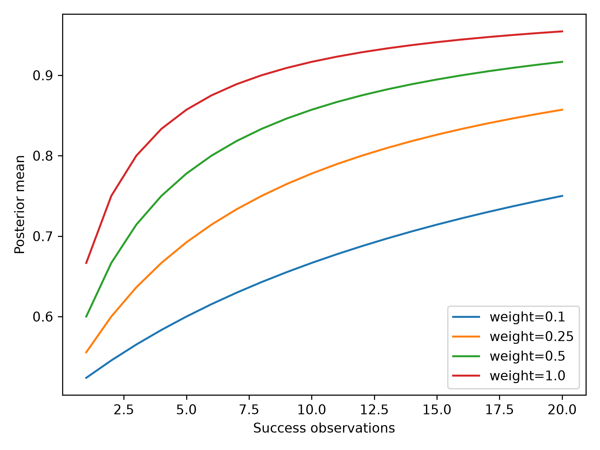

# 补天：依附宿主智能体的经验生命周期、证据约束与上下文恢复

内部研究论文草稿，2026-10-15。研究对象为 butian_plan 0.1.3；代码基线为 6be9552df1df4ee64da199d99aaf40c191ea8fa0。本文报告数学推导、数值控制和已有工程验证；同一宿主Agent对照实验尚未执行。

## 摘要

长程智能体容易把一次成功扩展为普遍规律，把外部文献主张直接当成自身经验，并在上下文压缩、版本变化与执行取消之后丢失任务状态。本文研究一种依附宿主 AI 应用的经验管理方法，将经验表示为带来源、环境、版本、证据和失效条件的候选对象，通过实践记录、冲突记账、审核、证伪与恢复形成生命周期。本文给出加权 Beta 更新、期望信息价值、目标总体标准化和预算选择的形式化论证，并使用生产数学模块执行数值控制实验。80 个后验分位数检查与 SciPy 参考实现一致，200 个八选项预算实例与穷举最优值一致；三种随机种子下的二元 Thompson Sampling 仿真分别有 992、994、985 次选择高收益臂。五类任务隐藏参考的数值部分得到复算，研究和数学专项测试共 19 项通过。以上结果支持限定输入上的数值实现一致性，不能证明补天提高宿主模型的任务成功率。预先定义的 B0/B1/B2、五类任务、三种种子共 45 个模型输入仍属于待执行协议，本文明确保留模型效果、成本与跨平台推广的证据缺口。

关键词：语言智能体；经验生命周期；证据约束；贝叶斯更新；上下文恢复；可复现实验

## 1 引言

智能体长期运行的困难不只在于保存更多文本，还在于辨认哪些文本可以支持当前行动。某次成功可能依赖特定固件、量纲、工具参数和操作顺序；当环境改变时，旧记录既可能提供有效迁移，也可能诱发错误。补天把记忆检索与经验有效性分开处理：检索只产生候选，候选进入行动还需要来源、版本和当前任务条件的核验。系统依附宿主应用提供的模型和会话，不要求同一宿主Agent服务。本文的研究问题是，经验生命周期与证据约束能否构成清晰、可检验的工程机制，以及这些机制的数学辅助组件在限定条件下是否正确。至于该机制能否改善实际模型行为，需要同一宿主Agent运行与配对分析，不能由软件单元测试推导。

本文贡献有三项。第一，给出经验候选、证据更新、失效、冲突和上下文恢复的统一工作定义。第二，整理数学模块的命题与适用条件，尤其区分后验置信度、事实真值、单次熵变化和期望信息增益。第三，提供带代码基线、种子、结果与文件哈希的可复现数值控制，并保留未执行的模型实验协议。论文不是第三方审计报告，结果来自本项目内部运行；既有发行回归和本次研究实验也分别记账。

## 2 相关工作与研究定位

文献检索记录位于 references/references.json。检索结果包含明显无关论文，本文只选取相关条目，全部原始记录保留。AgentCL（Shu 等，2026）以语言智能体持续学习评价为主题；Auto-Dreamer（Ye 等，2026）和 Self-Consolidation（Yu 等，2026）关注离线记忆整合与自演化；Get Experience from Practice（Feng 等，2025）讨论记录与重放。本文引用这些检索所得主题作为研究定位，不据此宣称其具体实验结论已复现。补天当前能够支持经验记录与恢复的工程链路，但没有运行这些论文的公开基准，也没有完成同等规模的模型对照。

主动学习方面，Houlsby 等（2011）的贝叶斯主动学习研究提供了以信息量选择观测的背景。人类记忆方面，Tulving（1983）的情景记忆、Howard 与 Kahana（2002）的时间上下文表征，以及 Godden 与 Baddeley（1975）的情境依赖记忆提示了来源和上下文的重要性。本文把这些思想转为工程假说：恢复时应携带当前 revision、证据来源和执行状态，而不是仅恢复一段摘要。这种类比没有建立人类心理机制与软件状态机的同一性；系统有效性仍须通过可观测的恢复结果检验。

## 3 形式化对象与系统机制

经验对象记为 e=(h,s,v,c,E,l)，其中 h 为可证伪的主张，s 为来源，v 为版本，c 为适用条件，E 为证据集合，l 为生命周期状态。外部论文主张首先进入 practice_hypothesis；本地工具执行、结果复核和审核形成新的证据，不允许仅凭引用自动转成稳定经验。冲突记录保留两个主张的来源与条件，在信息不足时返回 unknown。这里 unknown 是证据状态，不是失败的委婉表述。版本链用于追溯主张变化，上下文恢复则需要任务、计划 revision、工具执行记录和当前可确认状态相互一致。

生命周期的候选转移由显式分数归一化产生。若候选集合 C 中每个分数 z_j 非负且总和大于零，则 P(j)=z_j/Σz_k。此分布只表达调用者提供的候选偏好，不自行推导合法状态边，也不构成已经训练好的马尔可夫模型；当前参数 current 与 evidence 不能被解释为经验学习所得的转移概率。停止语义同样必须独立处理：提交取消请求只说明意图，未确认进程退出时应保留 unknown，不能把请求成功当成停止成功。

## 4 数学模型与论证

### 4.1 加权 Beta 更新

设先验 α>0、β>0，证据质量 q、独立性 d、环境匹配 m 均属于 [0,1]，有效权重 w=qdm。成功更新 α'=α+w，失败更新 β'=β+w。只要 w>0，新参数仍严格为正，Beta 分布合法。后验均值为 μ=α/(α+β)。成功更新的变化为 Δμ=wβ/[(α+β)(α+β+w)]≥0；固定失败参数并重复等权成功时，分母递增，边际变化递减。失败更新对应 Δμ=−wα/[(α+β)(α+β+w)]≤0。零权重在当前接口中被拒绝，因此“忽略证据”应由调用者跳过更新。

整数、独立的 Bernoulli 观测满足传统共轭解释；分数权重等价于加权似然或幂似然的工作模型，不能自动继承真实数据生成过程的校准保证。q、d、m 的乘积也不自动解决重复证据识别：若同一记录重复提交且 d 均设为 1，模型仍会人为增加证据强度。因此来源去重和独立性评估属于上层责任。95% 等尾后验区间由 Beta 分位数给出，与频率学派 Wilson 区间的覆盖语义不同。

### 4.2 熵与期望信息增益

对互斥、完备状态 S，H(p)=−Σ p_i log₂p_i。设观测 Y 的概率为 r_y，条件后验 p(i|y) 归一化，并满足完整混合恒等式 Σ_y r_y p(i|y)=p_i，则 EIG=H(p)−Σ_y r_y H(p(·|y))≥0。证明：熵为凹函数，对后验混合应用 Jensen 不等式即可；等价地，EIG 是联合分布与边缘乘积之间的 KL 散度。这个证明必须有完整一致性，逐元素检查 r_y p(i|y)≤p_i 只是必要约束，不足以代替混合恒等式。

当前 expected_information_gain 实现检查归一化、逐元素必要约束和最终熵差，但未完整检查后验长度与混合恒等式。本文实验仅使用完整一致的二元完美观测模型，不对任意输入声称实现严格互信息。单次观测的 H(prior)−H(posterior) 可以为负；当前 information_gain 拒绝这类输入，是“只接受熵减候选”的工程约束，不是贝叶斯理论要求每个观测都降低熵。动作分数 IG−λcost 同样是给定权重下的工作排序，不能保证最优长期策略。

### 4.3 分层效果与可识别性

对层 k，描述性差值 δ_k=mean(Y_T,k)−mean(Y_C,k)，目标总体权重 π_k≥0 且 Σπ_k=1，标准化差值 δ=Σπ_kδ_k。线性展开得到 δ=Σπ_k mean(Y_T,k)−Σπ_k mean(Y_C,k)，因此处理与对照使用相同目标总体，避免把组间不同样本构成误当效应。目标权重改变时 estimand 也改变，不能暗中换为等权或样本量权重。difference_in_means 返回的类名虽含 CausalEstimate，若没有随机分配、可交换性、正值性和一致性等识别条件，结果只能称描述性差异，不能称因果效应。

### 4.4 区间与小样本边界

Wilson 区间通过反解二项比例的 score 不等式得到；对 n>0，即使全成功或全失败也不会退化为零宽度区间。Student t 均值区间为 x̄±t_(0.975,n−1)s/√n，其精确覆盖依赖独立同分布正态样本；偏态、相关数据和自适应采样需要另行分析。n=1 时样本标准差及自由度为零的 t 区间均无定义，数据字典要求 null。三个种子并不等于三个同一宿主Agent；同一会话依次运行 B0/B1/B2 的污染也不能靠计算区间修复。

### 4.5 预算选择与排队边界

设选项 i 的净效用 u_i=quality−cost−risk，成本 c_i≥0，预算 B≥0，求 max Σu_ix_i，约束 Σc_ix_i≤B、x_i∈{0,1}。动态前沿从空集开始，每轮保留不选和可行选择；若状态 A 的成本不高于 B 且效用不低于 B，删去被支配状态不会损失后续最优解，因为后续可加入集合相同且效用可加。由归纳可知算法在未触发 100000 状态上限时保留一个最优可行解。该结论依赖选项独立、效用可加；工具依赖、互斥和协同收益不在模型内。状态上限意味着可能显式报错，不能称任意规模均可求解。

利用率 ρ=λ/μ 在标准单服务台平稳模型中用于稳定性判断。ρ≥1 提示长期负载风险；ρ<1 不保证某次任务的响应时延，也不能排除重尾服务时间或瞬时拥塞。Thompson Sampling 对每个二元奖励臂维护 Beta 参数并采样选择；本文没有证明其在非平稳智能体工具环境中的收益界，也没有把生成文本质量直接当作 Bernoulli 奖励。

## 5 实验设计

执行脚本为 run_mechanism_experiments.py，结果目录为 experiment_results/math-controls-20261015。实验类型固定为 mechanism_control，actual_model_runs=0。实验使用生产数学模块，SciPy 为独立数值参考，穷举为小规模组合优化参考。脚本记录代码 commit、Python、OS、随机种子，并生成结果 JSON、CSV、300dpi PNG 与 SHA256 清单。运行时不访问宿主模型、网络或身份凭据。原始文献和既有数据均保留，研究结果目录拒绝覆盖。

实验一在 q∈{0.1,0.25,0.5,1}、d=m=1 下进行 20 次连续成功更新，比较每一步等尾区间与 SciPy beta.ppf，容差为 10⁻⁹。实验二用固定种子生成 200 个八选项预算实例，比较稀疏前沿与全部 256 个子集的最优值，容差为 10⁻⁹。实验三在奖励概率 0.3 与 0.7 的两个平稳独立臂上，以三种种子各运行 1000 步。另以完美二元观测核验 1 bit 信息增益，并检查 λ∈{2,4,6}、μ=4 的负载边界。任务参考复算包含压力换算和五样本 t 区间；版本和恢复值只作为显式参考记录，不是执行器行为验收。

预注册模型协议包含 B0 当前会话、B1 固定记忆检索、B2 完整机制；五类任务和三种种子形成 45 个同Agent条件运行。实际执行使用同一个宿主Agent，轮换B0/B1/B2顺序，保存宿主、模型版本、条件顺序、上下文携带、预算、事件、评分与缺失成本。该协议尚未执行，本文没有提供B0/B1/B2比较表，也没有将确定性控制改写成语言模型答题结果。

## 6 结果

| 控制项目 | 实际数量 | 观察结果 | 解释范围 |
|---|---:|---|---|
| Beta 区间参考比较 | 80 | 全部绝对误差小于 10⁻⁹ | 选定参数网格 |
| 预算穷举比较 | 200 | 全部最优值误差小于 10⁻⁹ | 八选项、可加效用 |
| 完美二元观测 | 1 | EIG=1 bit | 一致的合成模型 |
| 负载边界 | 3 | ρ=0.5/1/1.5 | 阈值分类 |
| Thompson 仿真 | 3×1000 步 | 高收益臂次数 992/994/985 | 平稳二元合成环境 |
| 研究与数学专项测试 | 19 | 全部通过 | 指定测试集 |
| 同一宿主Agent实际运行 | 0 | 未执行 | 不提供模型效果结论 |

Thompson 三轮奖励总数为 678、727、724，不能把单个种子的奖励差异解释为机制优势；本次没有与均匀探索作配对比较。source_practice 复算均值 3、样本标准差 1.5811388300841895、自由度 4，95% 区间为 [1.0367568385224428,4.963243161477557]，与任务参考在浮点误差内一致。压力复算为 3400 Pa 与 1700 Pa=1.7 kPa。Beta 敏感性图说明低有效权重使相同次数成功对应更弱的均值变化，这只是公式行为，不是实际证据质量已经正确识别。

已发布 0.1.3 的工程回归记录为 946 passed、1 skipped、0 failed，属于前一阶段发行证据；本次未重新执行完整发行回归。该记录验证功能路径，不估计模型收益，也不等同第三方审计。

## 7 讨论、局限与后续验证

数值控制降低了公式实现错误与小规模优化错误的风险，但没有测量经验检索对语言模型的净贡献。合成数据完全满足预设模型，真实工具反馈则可能相关、延迟、含噪且跨版本变化。当前独立性和环境匹配权重仍由外部调用者提供，缺少数据驱动的校准证据；经验 lifecycle 的合法边和恢复 revision 也需要系统状态机保证，单独的转移归一化函数不能承担这一职责。信息增益接口的完整一致性检查不足已在正文披露，属于后续改进点，不能写成已解决。

下一阶段应运行独立 B0/B1/B2，优先报告分层结果与失败样本，按 case 和 seed 配对，必要时采用任务簇重采样而非把重复任务当独立样本。除成功率，还应测量无依据断言、unknown 诚实率、冲突处理、错误复发、审核负担和恢复质量。成本缺失保持 null。安全专项、独立执行器崩溃、完整真实 MCP 失联和跨平台验收仍按既定发行边界后置；这些未完成项不改变本文已执行数值控制，但限制产品普适性结论。

## 8 结论

本文完成了补天经验生命周期的形式化工作定义、七类数学组件的论证与限制说明，并实际执行数值控制与专项测试。结果支持选定参数上的后验计算一致性和小规模预算最优性，不能证明宿主智能体任务效果已改善。论文的可复现价值在于把推导条件、实现边界、实验结果和未执行内容分别保存，使后续模型实验能够建立在明确证据上，而不把准备工作或工程回归当成效果证明。

## 参考文献

以下元数据均取自检索脚本生成的 references/references.json；相关性筛选见 references/文献筛选记录.md。检索记录不是全文评审证据。

1. Shu 等. AgentCL: Toward Rigorous Evaluation of Continual Learning in Language Agents. 2026. 检索键 Shu2026。
2. Ye 等. Auto-Dreamer: Learning Offline Memory Consolidation for Language Agents. 2026. 检索键 Ye2026。
3. Yu 等. Self-Consolidation for Self-Evolving Agents. 2026. 检索键 Yu2026。
4. Feng 等. Get Experience from Practice: LLM Agents with Record & Replay. 2025. 检索键 Feng2025。
5. Houlsby 等. Bayesian Active Learning for Classification and Preference Learning. 2011. 检索键 Houlsby2011。
6. Tulving. Elements of episodic memory. 1983. 检索键 Tulving1983。
7. Howard 等. A distributed representation of temporal context. 2002. 检索键 Howard2002。
8. Godden 等. Context-dependent memory in two natural environments: on land and underwater. 1975. 检索键 Godden1975。
9. NIST/SEMATECH. Confidence Limits for the Mean. 固定快照 fixtures/nist-eda352-20261014.html；用于 t 区间方法说明。

## 研究执行边界更正

本文的比较对象不是独立模型。B0、B1、B2 是同一宿主 Agent 的机制条件消融；宿主模型、工具权限和任务包保持一致，实验记录条件顺序、上下文携带和先前答案暴露。本文此前的“独立模型对照”措辞均应理解为“同Agent条件比较”；0.1.4 的数学控制结果仍不等于真实 Agent 条件结果。
